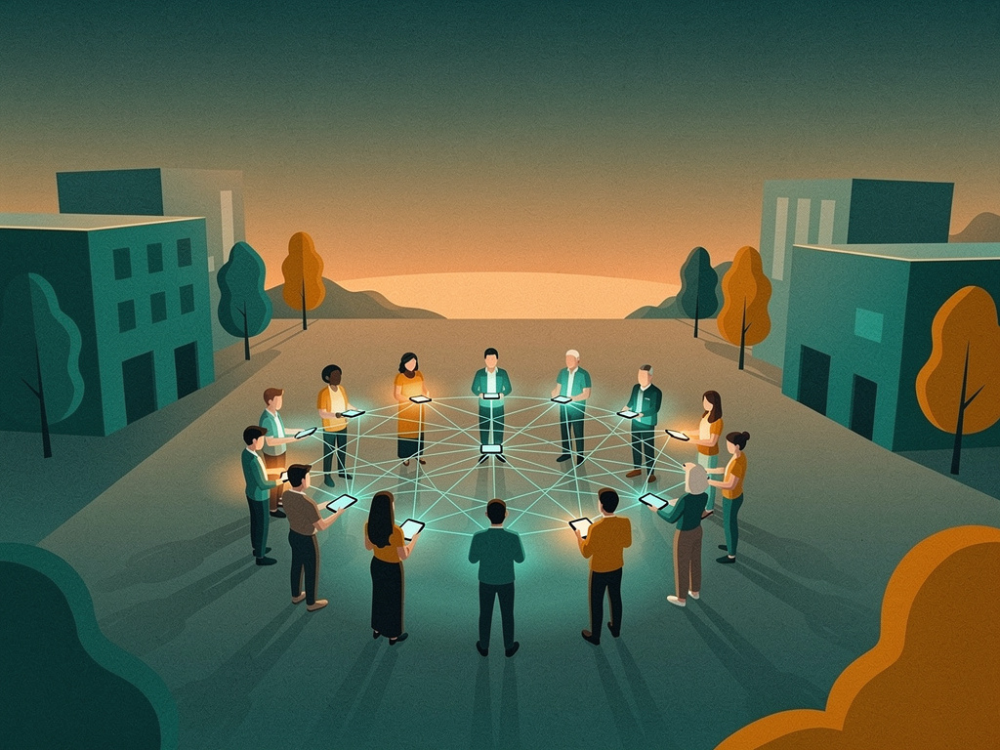

# Announcements

## Fundraising Campaign: Physical Hardware Testing Stage

*Emblem © 2026 Kirill Lapchinsky — not covered by the repository license.*

**Status: active · Estimated total: ~€2,300–2,400 · Prices may change**

Equality Project has been developed and verified entirely in emulators so far: the protocol core, consensus, the Flutter application, and the closed test network have passed all automated stages on emulated devices. The remaining block — **live testing on physical hardware ("8-live")** — cannot be emulated: it requires real devices with real secure hardware. This is the last gate before real-world pilots.

### What the funds are for

A compact test bench:

| Item | Purpose |
|---|---|
| Laptop — Lenovo IdeaPad Slim 5 14AGP11 (AMD Ryzen AI 7 445, 16 GB, 512 GB, 14″ 2.8K OLED) | Development machine: builds, two QEMU wallet instances, release tooling |
| 4× Samsung Galaxy A18 (Knox Vault, security updates until 2032) | The live test fleet: hardware key attestation on real Knox Vault, Bluetooth payments, wallet migration, seed circle (3 vouchers + 1 candidate), duress-PIN coercion testing, NSD/mDNS discovery over real Wi-Fi |
| Accessories: powered USB hub, GaN charger, cables, USB-C Ethernet adapter, external SSD, USB flash drives, 2× FIDO2 security keys, Wi-Fi repeater, travel router | Bench infrastructure: simultaneous ADB control of the whole fleet, stable networking, backups, account security, demos outside the home network |

### Budget

- Laptop + 4 phones (exact supplier prices): **€1,960.80**
- Accessories (quotes pending from the supplier): **~€300–400**
- **Estimated total: ~€2,300–2,400**

⚠️ **Prices may change**: accessory prices are supplier quotes still pending, and hardware prices fluctuate. The original equipment order (in Serbian, addressed to the local supplier in Podgorica) is published in this repository for full transparency: [funding/narudzbina-opreme-mbcom.md](funding/narudzbina-opreme-mbcom.md).

### How to contribute

Donations are accepted in crypto:

- **Ethereum:** `0xE8F95534B170885d9c6d319373a7f276F5742846`
- **Bitcoin:** `bc1qs7l9uqs67tjplzylj4sdx432puum4ya4es4le4`
- **Solana:** `5nsn5H158EYcDoERSCPHxjGjvrERT6NyNFtc84RRfqYq`
- **Tron:** `TGd98hbjgVaRBZ3a7XR5ExeZYK9yAkDxWn`

Campaign progress and reports: Telegram channel **[Equality Trust Networks](https://t.me/EQUALITY_TRUST_NETWORKS)** (@EQUALITY_TRUST_NETWORKS).

Contact: rumatakira74@gmail.com · Telegram [@rumatakira](https://t.me/rumatakira)

Every contribution goes directly to the one-time hardware purchase. The platform itself remains non-commercial and serverless by design: networks run on participants' phones with zero operational costs. This campaign covers the physical bench needed to prove the protocol on real devices — the final step before pilots.

© 2026 Kirill Lapchinsky
