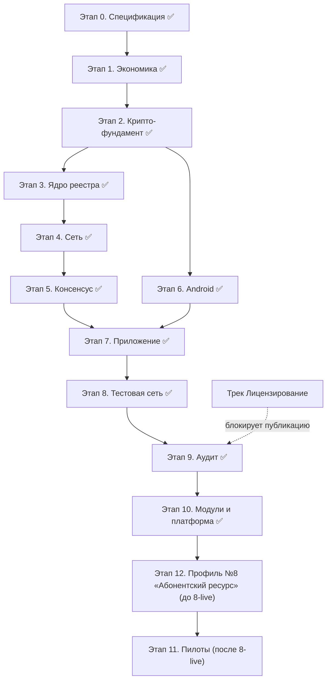

# План программирования платформы сетей доверия

Последовательность работ без привязки к датам. Основа — документ платформы v9.4 (разделы 3–19), в первую очередь дорожная карта раздела 19. Каждый этап имеет критерий готовности; следующий этап начинается, когда готов предыдущий (если не указано «параллельно»).

> **Обновлено 22.10.2026.** Этапы 0–10 и мини-этапы 11-й серии выполнены (этап 9 — аудит и решения владельца: `stage9-audit` — merge `53c4c2d`, мини-ветка `stage9-decisions` — merge `fad0dac`; этап 10 — модули и платформа профилей: ветка `stage10-profiles` слита в `main` — merge `9136772`, 20.10.2026, отчёт `reports/REPORT-STAGE-10.md`; спека v9.7). Зафиксированные параметры внесены по факту: K = 3, слоты 3/5/10, R = 10%, посевной круг ≥ 300 (этап 1); демередж 1% / 3000 периодов, комиссия rate ∈ [0.5; 2]%, P = 3000 / P_max = 30000 (этап 1.2); Snowball k = 10, α = 0.7, β = 4; epoch = 24 ч (№16), M = 21 (№17), seed_sunset = 100 active / 24 эпохи (№15), граница малых сетей ~100 участников (этап 5). Промежуточные релизы опубликованы: Zenodo 10.5281/zenodo.23474357 (equality-anti-farm-simulation), 10.5281/zenodo.23474316 (equality-trust-networks). Ветки: `stage6-android` (4e237bc) слита в `main`; `stage7-flutter` (c14ee0f..fcc0644) слита в `main` (merge `588dfed`, 20.10.2026; tip main `a673420`). Правило ветвления (20.10.2026): каждый этап — отдельная ветка от `main`; после подтверждения владельца CLI пушит ветку и вливает её в `main`. Чистка .gitignore (19–20.10.2026, `565f4bb` + `c8a1388`): глобальные шаблоны всех кешей и генератов (build/, .gradle/, .dart_tool/, .cxx/, captures/, local.properties, .idea/, *.iml, .vscode/, *.swp, .DS_Store, Thumbs.db, *.prof и др.); артефакты сборки (757 файлов, 191,5 МБ) были только staged, ни в одном коммите — история не переписывалась, обычные пуши. Подэтап 8.1 выполнен 20.10.2026 (ветка `stage8-1-simulation` слита в `main` — merge `7c37bd7`; tip main `b0fa7ba`): оба прогона, блокеры ANR/E_DUP закрыты, находки №39–№42. Мини-этап stage11-prep (формализация решений №44–№46, сверка спеки v9.8, эмуляторный прогон «кража → восстановление») выполнен и слит в `main` 21.10.2026 (merge владельца `932ca8b`; отчёт `reports/REPORT-STAGE-11-PREP.md`; 8 PENDING-находок — кандидаты в мини-ветку фиксов до `stage11-2-guardians`). Мини-этап stage11-1-fixes (фиксы находок прогона stage11-prep: low-s Keystore-подписей №1, окно челленджа UI заявляемого периода №2, nonce в StartMigration №5, флаг -migrate-delay-days №6) выполнен и слит 21.10.2026 (merge `53bda9c`; отчёт `reports/REPORT-STAGE-11-1-FIXES.md`). Мини-этап stage11-2-guardians (перевыбор личных гардианов `update_guardians` по спеке v9.8: окно 48 ч, отмена PIN-only, лимит 150 вступивших в силу смен; протокол+ядро, экран «Гардианы» и экран согласия, i18n ×5; эмуляторный прогон «публикация → отмена в окне → вступление в силу») выполнен и слит 21.10.2026 (merge `c59823e`; отчёт `reports/REPORT-STAGE-11-2.md`; PENDING 1–7 — кандидаты в следующую мини-ветку и блок 8-live). Мини-этап stage11-3-fixes (фиксы из PENDING stage11-2: №2 — периодический flush зрелых отложенных операций после рестарта узла, применяется после первичной сверки (settle «впереди» синхронизации ломал исторический демередж холодной сверки — поймано converge-тестом); №3 — таймаут биометрии не вешает UI, отмена диалога возвращает экран в рабочее состояние; №4 — History перезапрашивается после рестарта; №6 — hex-чанки по 20 с контролем длины/символов + контроль поля списка «новые гардианы» (находка прогона); №7 — клавиатура не перекрывает кнопки) выполнен и слит 22.10.2026 (merge `855737e`; ветка b7d25b8..c89a4d6, 3 коммита; отчёт `reports/REPORT-STAGE-11-3-FIXES.md`; скриншоты reports/stage11-3-fixes/01–31; flutter test 43/43, go test + race по задетым зелёные). PENDING №1 (семантика подписи гардиана — решение владельца, до пилотов) и №5 (способ сдвига часов для прогонов — вне кода) остаются открытыми. Этап 12 добавлен 27.10.2026 (решения владельца по профилю №8 «Абонентский ресурс»: recurring-единицы с периодной меткой и сгоранием, само-сертифицирующийся network_id, зарезервированный network_id "global" для глобальной сети, genesis-валидация комбинаций; внести в спеку, код и документацию). Порядок (решение владельца 27.10.2026): этап 12 реализуется до блока 8-live.

---

## Этап 0. Спецификация протокола — ✅ выполнено

Формализовать документ до вида, по которому можно писать код и те
сты.

- [x] Wire-формат всех транзакций (раздел 9.3): protobuf-схемы, поля `wallet`, `seq`, `prev`, `type`, `payload`, `timestamp_claim`, `protocolVersion`, подпись.
- [x] Формат genesis-пакета и манифеста сети (разделы 3.3, 4): схема полей, хеш манифеста, `mutable_bounds`, посевной круг.
- [x] Правила проверки каждого типа транзакции каждым узлом — таблицы «условие → принять/отклонить» для всех типов ядра.
- [x] Инварианты ядра (раздел 3.2) как проверяемые утверждения INV-1..14.
- [x] Тестовые векторы: корректные транзакции, эквивокация, двойной выпуск, мораторий, окно накопления.
- [x] Черновик машины состояний кошелька: `registered → active → expired`, метка `flagged`, слоты поручителя.

**Готовность:** ✅ спецификация v1 с тестовыми векторами (`spec/` 00–07, `proto/`, `vectors/` — 20 векторов, `QUESTIONS.md`).

**Открытые вопросы, закрытые здесь:** формат чекпоинта ✅ (`spec/07`); схема пороговой подписи ✅ — N-из-M из набора подписей ECDSA P-256 (не BLS).

---

## Этап 1. Параметры сети: экономика и защита от ферм

### 1.1 Экономика поручительств и фермы — ✅ выполнено

Реализовано и опубликовано: репозиторий `equality-anti-farm-simulation` (Python, агентная модель):

- честный рост через поручительства: K, слоты 3/5/10, возраст поручителя ≥ 3 мес., слот освобождается после 3 выпусков поручаемого или 3 мес. без активации;
- ферма: покупка устройств, проникновение к честным поручителям, рост кольцом взаимных поручительств;
- экономика фермы: стоимость устройства и электричества, утечка 10% выпуска первым 12 периодам поручителям; главная метрика — безубыточная цена единицы;
- прогнанные сценарии: K = 2–5, узкие и щедрые слоты, проникновение 0–20 кошельков/мес., посевной круг 50–1000, бюджет фермы 5–100 устройств/мес.

Что осталось по этой модели:

- [x] Зафиксировать выбор K, S, R отчётом по результатам прогонов (раздел 17). ✅ Зафиксировано: K = 3, слоты 3/5/10, R = 10%, посевной круг ≥ 300 — обновлён раздел 7.7 KNOWLEDGE.md (v9.2) и таблица раздела 17.
- [ ] Калибро
вка допущений честного роста на реальном сообществе (закроется первым пилотом профиля 1).
- [ ] Расширить ту же модель: демередж, комиссия, мораторий на вывод — сейчас не моделируются.

### 1.2 Параметры — ✅ закрыты (отчёт 1.2, equality-anti-farm-simulation/Mistral/REPORT.md, раздел 5)

- [x] P и `P_max` отложенного перевода (раздел 8.3, вопрос 4 раздела 18) — **P = 3000, P_max = 30000**.
- [x] Демередж для профилей 5 и 7 — **1% / 3000 периодов**.
- [x] `fee_min`, границы `[rate_min, rate_max]`, целевой рост предложения — **адаптивная rate ∈ [0.5; 2]%, fee_min = 0.01**.

Значения реализованы в `core/params` (этап 3); туда же — окно переводимости свежих выпусков 3 мес. (`fresh_transfer_window_periods`, вопрос №11).

### 1.3 Симуляция реестра и консенсуса — перенесена в этап 5, выполнена там ✅

Конфликты, эквивокация, двойной выпуск, потеря связности, голосование и чекпоинты на сотнях узлов — это симуляция протокола, а не экономики. Выполнена в Go headless-ядре как «проверка до реализации» (раздел 9.1) в этапе 5.

**Готовность этапа 1:** ✅ K/S/R подтверждены отчётом; демередж, комиссия и P выбраны прогонами расширенной Python-модели.

---

## Этап 2. Криптографический фундамент ядра — ✅ выполнено (подэтап 3.0, ветка stage3-core)

- [x] Подписи ECDSA P-256 (`crypto/ecdsa`); фиксация формата ключа и адреса (`walletFingerprint`).
- [x] PoW: лёгкий (на `transfer`) и memory-hard на базе Argon2id (`x/crypto/argon2`) для `register` и выпуска; параметры под средний телефон — таргеты финализируются замерами на устройстве (этап 6, вопрос №9).
- [x] Sparse Merkle-дерево состояния (балансы + `seq`): построение, включение, доказательства для лёгких узлов.
- [x] Пороговая подпись чекпоинтов: N-из-M из набора подписей ECDSA P-256 (решение этапа 0), режимы `decentralized` и `members_quorum`.
- [x] Разбор цепочки аппаратной аттестации Android через `encoding/asn1`: синтетические корни для тестов; реальные цепочки Google, `verifiedBootState`, `deviceLocked`, уровень патча — на живом ус
тройстве в этапе 6 (№23 → вопрос 7).

**Готовность:** ✅ все криптопримитивы ядра покрыты тестами, включая векторы аттестации (синтетические; реальные — этап 6).

---

## Этап 3. Ядро реестра (без сети) — ✅ выполнено (ветка stage3-core, c7e7df1; отчёт core/REPORT-stage3.md)

- [x] SQLite-хранилище (раздел 12.5): цепочки, индекс «фингерпринт → адрес», данные лёгкого узла, заголовки чекпоинтов.
- [x] `register`: аттестация + усиленный PoW, один фингерпринт = один адрес, запрет второго кошелька на уровне приложения.
- [x] `vouch`: K поручительств, возрастной порог, пул слотов по возрасту, освобождение слота.
- [x] `mint`: `periodic_equal`, `period − 1` при первом, окно накопления 6 мес., челлендж в рандомном слоте ±48 ч, доля R поручителям из первых 12 выпусков.
- [x] `transfer`: сжигаемая комиссия (адаптивная `rate` на границе эпохи), мораторий 14 дн., отложенные крупные переводы (порог P, задержка D = 48 ч, отмена, повышение P через 48 ч).
- [x] Демередж: детерминированный эффективный остаток, без транзакций списания.
- [x] `evidence`: закрытый перечень (эквивокация, двойной выпуск), мягкие последствия — метка `flagged`, приостановка выпуска, прекращение доли поручителям.
- [x] `migrate` и гардианы: личные 2 из 3, публичные 3 из 5, задержка 14 дней и отмена, перенос возраста и истории, чёрный список фингерпринтов, лимит G_max.
- [x] Смена параметров (`params_mutable`): предложение → окно подписей → порог ≥ 2/3 → задержка ≥ 30 дней → активация в эпоху; неретроактивность; сборка форк-пакета одной командой.
- [x] Fuzzing и property-based тесты на инварианты ядра из этапа 0.

**Готовность:** ✅ ядро проходит полный набор тестов спецификации (12/12 векторов, property-поток 400 операций с INV, метаморфные мутации, сквозной сценарий, сеттлемент).

---

## Этап 4. Сеть (go-libp2p) — ✅ выполнено (ветка stage4-network, 7853874; отчёт reports/REPORT-STAGE-4.md)

- [x] Транспорт QUIC/TCP, Noise, DHT (Kademlia), GossipSub.
- [x] Bootstrap-каскад (раздел 12.3): кэш пиров → подписанн
ые seed-списки → зашитый список в APK → NSD/mDNS → Bluetooth-скан → QR → ручной ввод; peer exchange.
- [x] Hole punching и circuit relay через добровольные полные узлы (CGNAT) — DCUtR + circuit relay v2, эмуляция в тестах.
- [x] Уровни узлов (раздел 12.2): полный / лёгкий, переключение по условиям (зарядка + Wi-Fi).
- [x] `invite_only`-сети: ключ сети в приглашении (QR/ссылка), фильтрация пиров по `network_id`.
- [x] Защита от eclipse: смешивание источников, подтверждение от N несвязанных пиров (№35: Peer ID — сделано; подсети/ASN — этап 6); тест изоляции узла.
- [x] Bluetooth-канал (раздел 12.4): SideChannel — прямая передача подписанной транзакции, статус «ожидает публикации», проверка `seq`/`prev` при публикации.

**Готовность:** ✅ headless-узлы на разных машинах синхронизируют реестр; eclipse-тест пройден.

---

## Этап 5. Консенсус: голосование, чекпоинты, эпохи — ✅ выполнено (ветка stage5-consensus, локальная; отчёт reports/REPORT-STAGE-5.md)

Зафиксировано симуляцией и утверждено 18.10.2026: Snowball k = 10, α = 0.7, β = 4, веса по возрасту + аттестации; №16 epoch = 24 ч; №17 M = 21; №15 seed_sunset = 100 `active` / 24 эпохи; граница малых сетей `members_quorum` — ~100 участников.

- [x] Выборочное голосование: повторяющийся опрос выборки пиров, веса по возрасту и аттестации кошельков.
- [x] Чекпоинты: подписанный пороговой подписью корень состояния, режимы `decentralized` / `members_quorum`, переходный режим посевного круга с расписанием `seed_sunset`.
- [x] Сетевое время (раздел 9.2): эпохи как источник правды, допуск timestamp ±30 мин, предел сдвига между чекпоинтами.
- [x] Симуляция на сотнях виртуальных узлов (требование раздела 9.1): все 8 сценариев, детерминированная по seed.

**Готовность:** ✅ финальность 4 раунда (= β) во всех агрессивных сценариях; злонамеренные до 30% — честная ветка побеждает; поведение при разделении задокументировано; граница малых сетей определена; чекпоинты подписываются во всех трёх режимах; лёгкий узел проверяет доказательст
во по чекпоинту.

---

## Этап 6. Android-платформа (Kotlin + связка с ядром) — ✅ выполнено (ветка stage6-android, 4e237bc, слита в main; отчёт reports/REPORT-STAGE-6.md)

Можно начинать после этапа 2, параллельно этапам 3–5: проверка Keystore и аттестации на устройствах не зависит от сети. Фактически выполняется после этапа 5: ветка `stage6-android` от `stage5-consensus`. Промпт: `prompts/stage-6-prompt.md`.

- [x] **Подэтап 6.0 — долги:** подпись ответов голосования в сети (cons/net, долг этапа 5); несвязанность eclipse-пиров по подсетям/ASN (№35, хвост этапа 4); закрепление утверждённых №15/№16/№17 и границы малых сетей в `QUESTIONS.md` и params/genesis.
- [x] Интеграция ядра: `gomobile bind` (AAR) или `c-shared` + `dart:ffi` — выбрать по замерам; foreground service, platform channels, protobuf-обмен.
- [x] Keystore: ключевая пара с `setAttestationChallenge`, `setUserAuthenticationRequired(true)` на каждую операцию, `setInvalidatedByBiometricEnrollment(true)`, `BIOMETRIC_STRONG`.
- [x] Подтвердить на целевых устройствах: ECDSA P-256 везде, поддержка Ed25519, разбор расширения аттестации (вопрос 7 раздела 18).
- [x] Экран биометрии: отказ в регистрации без настроенной биометрии, системный экран добавления отпечатка.
- [x] PIN: обычный и тревожный (раздел 8.2), неразличимость, отключение входа по отпечатку при включённом тревожном, режим-приманка без использования ключа подписи.
- [x] `allowBackup=false`, получение актуального `seq` от нескольких пиров перед подписью.
- [x] Bluetooth-передача транзакции, NSD/mDNS-обнаружение для локальной Wi-Fi-сети.
- [x] Замеры ресурсов (раздел 12.1): размер сборки, память, энергия, DHT в клиентском режиме; лёгкий режим узла; финализация таргетов PoW №9.

**Готовность:** ✅ AAR (`gomobile bind`) собран и связан с ядром: регистрация, подпись, проверка транзакций; Keystore + BIOMETRIC_STRONG, PIN, аттестация, замеры зафиксированы (reports/REPORT-STAGE-6.md). Живой телефон — чек-лист reports/stage6/ (PENDING, не блокер).

---

## Эта
п 7. Приложение (Flutter) — ✅ выполнено (ветка stage7-flutter, c14ee0f..fcc0644, слита в main merge 588dfed 20.10.2026; отчёт reports/REPORT-STAGE-7.md, скриншоты reports/stage7/01–17)

- [x] Онбординг: создание кошелька, обязательное предложение гардианов при создании, настройка биометрии.
- [x] Поручительства: QR и Bluetooth при личной встрече, статус кандидата, слоты.
- [x] Кошелёк: баланс, история, выпуск с челленджем, переводы, отложенные переводы с отменой, Bluetooth-платёж со статусом «ожидает публикации».
- [x] Реестр и репутация: публичная история, возраст, глубина графа поручительств, статистика поручителя.
- [x] Миграция: запуск, отмена, публичные гардианы, перезапуск с новыми поручительствами.
- [x] Интерфейс режима-приманки: правдоподобный остаток и история, «ожидает подтверждения».

**Готовность:** ✅ полный путь в эмуляторе: регистрация → гардианы → vouch×3 (V1..V3) → `ACTIVE` → выпуск 1000 → 901 (доля поручителей R ≈ 9,9%) → перевод 50 + комиссия 1 → 850; история, миграция, QR, Bluetooth-канал — экраны готовы (reports/stage7/01–17). Живой телефон и Bluetooth-платёж — чек-лист отчёта (PENDING). go test 10/10 (+race), flutter analyze/test — чисто.

---

## Этап 8. Закрытая тестовая сеть — ✅ выполнено 20.10.2026 (ветка `stage8-testnet` слита в `main` — merge `7271b34`; отчёт `reports/REPORT-STAGE-8.md`)

Промпт: `prompts/stage-8-prompt.md`.

**Ограничение (19.10.2026):** у владельца нет Android-устройства (iPhone). Весь код, утилиты и ранбук пишутся и проверяются в эмуляторе; всё, что физически требует живого Android-телефона, — отложенный блок 8-live (не блокирует этап 9).

- [x] **Подэтап 8.0 — долги этапа 7 закрыты:** слот mint считается от genesis-времени (календарные периоды 9.2, вопрос 18), тесты добавлены; `SkipMintChallengeWindow` → false (окно M7 проверяется при apply, реальное окно ±48 ч проверено на тестнете в обе стороны); syncLoop — диагноз: первый проход шёл до identify пира, ошибка глоталась; фикс — сверка журнала по событию identify; №38 
— узел in-memory (SQLite на живом телефоне — блок 8-live); Fee = RateMin — не трогали (полная комиссия — этап 10).
- [x] Genesis-утилита `cmd/tnp-testnet`: генерация genesis-пакета/манифеста/seed-списка/приглашений (invite_only, параметры KNOWLEDGE 4/17) + декодер genesis-пакета (аддитив) + tx-драйверы; сборка сети проверена в эмуляторе: узлы из genesis-файла + приложение (журнал 11 tx синхронизирован).
- [x] Release-APK: R8 + debug-подпись, 163,5 МБ, установка и запуск в эмуляторе чистые; живые устройства — блок 8-live.
- [x] Ранбук `reports/stage8/TESTNET-RUNBOOK.md` — написан целиком с пометкой «к прогону после появления Android-устройств (блок 8-live)».
- [x] Эмуляторный прогон (артефакты + скриншоты reports/stage8/01–09): окно челленджа (accept в окне / E_POW_HARD вне), эквивокация → conflict-ветка → `evidence` → `flagged` → E_VOUCH_FLAGGED, отложенный перевод 3500 с отменой, комиссия, vouch (±E_VOUCH_PERIODS), миграция propose+cancel, холодный старт с нуля; приложение: онбординг с биометрией → vouch×3 → `ACTIVE` → выпуск 901 → перевод 850 → тревожный PIN (приманка 847, возврат к реальному кошельку).
- [x] Тесты и CI: `go test ./...` зелёный, race `net/query` зелёный, `flutter analyze`/`test` чисто; CI обновлений не потребовал.

**Отложено — блок 8-live (до появления Android-устройств):** установка APK на живые устройства, разные производители/версии; Bluetooth-платёж и Bluetooth-vouch; аттестация на реальном железе; SQLite на живом телефоне (№38); посевной круг из нескольких живых людей; тест принуждения на живом устройстве; замеры ресурсов; NSD/mDNS в реальном Wi-Fi.

**Готовность:** ✅ выполнено 20.10.2026 — все пункты закрыты; блок 8-live зафиксирован в отчёте как отложенный. Живые прогоны — критерий блока 8-live (не блокирует этап 9; блокирует этап 11 — пилоты).

**Находки этапа 8:** №39 (новый, ждёт решения владельца): при буквальной семантике окно челленджа достижимо лишь для ~1/15 слотов — требуется решение о якоре слота; №40 (новый, кандидат в этап 9): 
`cons.Replay` пинирует только NetTime → демередж при пересчёте из БД расходится с холодной синхронизацией (Δ125, root A/B ≠ C); PinManager-баг (исправлен): с заданным тревожным PIN приложение блокировалось навсегда — латентно с этапа 6, вскрыто прогоном; `cmd/tnp-node` отсутствовал в git (паттерн .gitignore) — исправлено.

---

## Подэтап 8.1 — масштабная симуляция: 50 узлов — ✅ выполнено 20.10.2026 (ветка `stage8-1-simulation` слита в `main` — merge `7c37bd7`; отчёт — раздел «Симуляция 50 узлов» в `reports/REPORT-STAGE-8.md`; артефакты `reports/stage8/sim50/`; промпт `prompts/stage-8-1-prompt.md`)

Цель — проверить поведение сети и приложения при посевном круге в 50 участников на одном ноутбуке владельца (16 ГБ RAM + 7 ГБ подкачки). Bluetooth не используется (и так блок 8-live).

**Ограничение:** 50 эмуляторов QEMU нереально — один эмулятор съедает ~4 ГБ RAM (фактический замер прогона этапа 7: посевной круг V1–V3 внутри одного эмулятора). Рабочая схема: **48 headless Go-узлов (`tnp-node`, ~12 МБ на узел — замер этапа 8; всего <1 ГБ) на localhost + 2 эмулятора с реальным Flutter-приложением (по ~3,8 ГБ RAM на эмулятор — замер этапа 8)**. Уточнение 20.10.2026: цифры «2,6 ГБ» (QEMU) и «2,9 ГБ» (CLI) в таблице процессов — суммарное чтение с диска, НЕ своп; реальный бюджет 8.1: 2×3,8 (эмуляторы) + ~1–2 (48 узлов с состоянием) + 0,7 (CLI-агент) + ~0,5–2 (рабочий стол) ≈ **~10–13 ГБ RAM — влезает в 15,1 ГиБ практически без свопа** (наблюдаемые 4,1 ГиБ свопа — вероятный след сборочных пиков Gradle, не устойчивая потребность). Перед прогоном остановить Gradle-демоны (−3,1 ГБ RAM) и закрыть браузер (−2,3 ГБ RAM). Замер CPU прогона этапа 8: один эмулятор ~20% ядра — CPU не узкое место (запас ~5 ядер из 8); диск эмулятора за прогон: чтение ~2,6 ГБ + запись ~4 ГБ. Порядок запуска: сначала headless-узлы и связность, потом эмуляторы. Если тормозит — сокращать headless-узлы (50→40→30) или оставить 1 эмулятор.

- [x] Seed-режим через `cmd/tnp-testnet`: тестовый genesis — малые PoW-
таргеты (как тестовые окружения этапа 6), seed-список, параметры из KNOWLEDGE 4/17. **Два прогона с разными эпохами** (длина эпохи — параметр `epoch_seconds`, влияет на достоверность периодной механики, не на нагрузку): (1) флот 48 headless-узлов без эмуляторов, эпоха 1–2 мин (~30–40 мин прогона) — связность, throughput, финальность, чекпоинты; (2) полный прогон с 2 эмуляторами, **эпоха 5 мин (~2–2,5 ч)** — периодная механика в осмысленном масштабе: операция ≪ эпоха (PoW 10–20 с — до ~4% эпохи, как в продакшене ~0,02%), UI-путь участника не пересекает несколько периодов, окна челленджа и M4 проверяются по логике, а не случайно; 24 эпохи `seed_sunset` проходят за ~2 ч. Итоговая длительность ~3 ч.
- [x] Полный путь 50 участников: регистрация, vouch, минты в окне челленджа, переводы (обычный, отложенный с отменой), комиссия, демереж, миграция, тревожный PIN.
- [x] **Требование безопасности UI (решение владельца 20.10.2026):** перевод и все деструктивные операции (выпуск, миграция propose, смена/удаление PIN) — только явный ввод PIN (реального или тревожного); вход — отпечаток или PIN; биометрия — только для разблокировки/просмотра; сохраняется правило этапа 6 (раздел 8.2): при включённом тревожном PIN вход по отпечатку отключён — PIN-only и на входе, иначе приманку обходят на входе силой. Принцип: PIN-промпт — точка входа в режим-приманку; биометрия принуждаема физически (палец прикладывают силой), PIN-ввод сохраняет жертве выбор. Убрать биометрическое подтверждение с экрана перевода и всех деструктивных экранов; тест: перевод требует PIN, тревожный PIN на экране перевода открывает приманку, после переводов и рестарта тревожный PIN жив. Формулировка в спеку (раздел 8.2) — этап 9; реализация PIN-only на деструктивных экранах и тесты — этап 9 (аудит защиты владельца).
- [x] `seed_sunset`: при 50 узлах сработает только ветка «24 эпохи» (порог 100 active недостижим); чекпоинты O(N) на границе `members_quorum` ~100 — зафиксировать метрики.
- [x] Наблюдение за эмуляторами с 
приложением в толпе (регистрация, выпуск, перевод при 50 узлах).
- [x] Тесты и CI не ломаются; результаты и метрики — в `reports/REPORT-STAGE-8.md` (раздел «Симуляция 50 узлов»).
- [x] **Уборка процессов (после каждого прогона):** остановить Gradle-демоны и завершить оставленные процессы (`tnp-node`, `tnp-testnet`, `qemu-system-x86_64`) — они переживают запуск и накапливаются; перед стартом следующего прогона убедиться, что старых нет (`pgrep`).

**Итоги 8.1 (20.10.2026):** прогон 1 (SQLite, эпоха 90 с): 48 узлов, RSS 46–61 МБ (мед. 52→57); прогон 2 (память, эпоха 5 мин): эра 1 — журнал 143 tx, 50 ACTIVE, seed_sunset (эпохи 1–23 строит node29, с 24 — decentralized-выборка); эра 2 — минты P=3 28/28 (№39 подтверждён: окна у якоря, вне окна E_POW_HARD, UI блокирует), демередж S81 5000→5178 (floor 3000, −20 граница, +198 поручителям), наблюдатель-узел 49 холодной сверкой — root идентичен, перевод 50 принят (100→49, комиссия 1 сожжена), журнал 172, state_root `1d9d76c6…b48a3`; повтор эры 2 (инцидент рестарта сессии) воспроизвёл root детерминированно. Чекпоинты при 50 участниках: 14 подписей ≤40 с; LinkGroups=false подтверждён (прод-дефолт включён). **Блокеры закрыты:** ANR — весь cgo off-main (рестарт-тест чист, tid≠pid, 0 E_DUP), E_DUP — дедуп txid в gossip до apply. **Открыто в этап 9:** №40 — старт-блокер (store-replay из БД: E_VOUCH_EPOCH ×96; временный путь — `net.ImportJournal`), №41 — инкрементальный якорь сверки, №42 — `cpEpochOverdue` при выпадении детерминированного строителя (600 с при эпохе 300 с), реализация PIN-only, формализация 8.2/№39 в спеку.

**Готовность:** ✅ выполнено 20.10.2026 — seed-режим утилитой этапа 8; 48 headless-узлов + 2 эмулятора одновременно на ноутбуке владельца; полный путь 50 участников пройден; метрики в отчёте; процессы убраны (`879b87e`).

---

## Этап 9. Аудит — ✅ выполнено 20.10.2026 (ветка `stage9-audit` слита — merge `53c4c2d`; мини-ветка `stage9-decisions` слита — merge `fad0dac`; отчёт `reports/REPORT-STAGE-9.md`; промпт `prompts/stage-9-prompt.md`)

- [x] Независимый аудит криптографии (подписи, PoW, Merkle, пороговые подписи): маллеабельность ECDSA закрыта — каноничный DER + low-s (`09738c0`, регресс-тест `93bada0`); новых критичных находок нет.
- [x] Аудит консенсуса (голосование, чекпоинты, eclipse): три гонки (Snowball, `cons.Clock`, cheapCheck/StateRoot) закрыты (`9be07ac`), race 20 → 0; CI android — AGP 8.9.1 (`2079bc6`).
- [x] Аудит разбора аттестации и защиты владельца (тревожный PIN, отложенные переводы): новых критичных находок нет; тайминговая различимость режима-приманки зафиксирована в отчёте честно.
- [x] Исправления и повторная проверка критических и высоких находок: №40 — пинирование Epoch/Period при Replay из БД (`353a742`, `b9a02ab`); №41 — позиционный якорь `SyncJournalFrom` (`4ce411d`, `be82cf4`); PIN-only на деструктивных экранах приложения (`186d18c`); спека v9.5 (`6c504ae` — раздел 8.2 + якорь слота №39); отчёт `reports/REPORT-STAGE-9.md` (`63d8060`).
- [x] **Скоуп подтверждён владельцем 20.10.2026 (закрытие блокеров 8.1):** №40 — пинирование Epoch/Period при Replay из БД в `cons/` (сходимость store-replay с холодной синхронизацией, state_root A=B=C, расхождение демереджа Δ125 закрыто, регресс-тесты рестарта из БД; `net.ImportJournal` остаётся путём восстановления); №41 — инкрементальный якорь `SyncJournalFrom` (позиционный after — сверка не квадратична по трафику); №42 — семантика `cpEpochOverdue` при выпадении детерминированного строителя чекпоинта (варианты с трейдоффами — `QUESTIONS.md`, решение владельца, протокол не менять до решения); реализация PIN-only на деструктивных экранах приложения + тесты; формализация в спеке v9.5 — раздел 8.2 (правила безопасности UI) и якорь слота №39. Промпт: `prompts/stage-9-prompt.md`.
- [x] **Решения владельца — мини-ветка `stage9-decisions` (3 коммита, merge `fad0dac`, 20.10.2026):** №39 ✅ — якорь слота — календарные периоды от genesis; №42 ✅ — (A) очередь строителей (первые K участников состава, ротация epoch/2, genesis-поле `cp_builder_queue`) + (D) пропуск застрявшей эпохи (пустой гэп нумерации; подписанты принимают last+2 только при исчерпанной очереди), спека v9.6 «пустая эпоха» (`91c2154`); №43 ⏳ — отзыв аттестации (CRL/OCSP) отложен для v1 (пересмотр при реальных корнях / блоке 8-live), минор-фикс «будущая дата патча» принят; 5 новых тестов + 2 устранённых флака; `go test ./...` и `-race` чистые.

**Готовность:** ✅ выполнено 20.10.2026 — отчёт аудита (`reports/REPORT-STAGE-9.md`), критические и высокие находки закрыты и перепроверены; №40/№41 реализованы; №39 и №42 решены владельцем (якорь слота от genesis; очередь строителей + пропуск пустой эпохи (A)+(D), спека v9.6); №43 отложен для v1. Промежуточные релизы (Zenodo, GitHub) уже опубликованы по решению пользователя; дальнейшие публикации и продвижение — после трека «Лицензирование».

---

## Этап 10. Модули и платформа профилей — ✅ выполнено 20.10.2026 (ветка `stage10-profiles` слита в `main` — merge `9136772`; отчёт `reports/REPORT-STAGE-10.md`)

Промпт: `prompts/stage-10-prompt.md`.

- [x] **Адаптивная комиссия (долг 8.0):** замена заглушки `Fee = RateMin` детерминированным пересчётом `rate` на границе эпохи из данных чекпоинтов (раздел 10.2 спеки; rate ∈ [0.5; 2]%); genesis-поля 57–59 (`fee_adjust_epochs`, `fee_target_growth_micros`, `fee_step_micros`), источник — `total_supply` финализированных чекпоинтов, рестарт из БД (тест эквивалентности), `fee_mode = POOL` — общий фонд; параметры пересчёта — черновые дефолты, №44 (этап 11).
- [x] `attest` + проверяющая библиотека (Go; сборки JVM и JS — №45, этап 11): подпись кошелька, Merkle-доказательство из чекпоинта, `challenge`, срок годности, `H(address ‖ app_id)`; лёгкий клиент-синхронизатор — `core/present` (Verify + LightSync): верификатор проверяет предъявление без полного узла.
- [x] `redeem`: погашение с `resource_id`, квоты `quota_reset`, подписанные `receipt` (payload-теги 17–24).
- [x] `pool`: `pool_create/donate/close/claim`, режимы выпуска, возврат.
- [x] `contribution`: `contribution_claim/confirm`, подтверждения `peer`, лимиты, потолки, выплата из пула (числа — константы `core/ledger/modules.go`, №46 — этап 11).
- [x] `sandbox`: синтетические кошельки, headless-режим, экспорт реестра для анализа (json/csv, режим `export` в `tnp-testnet`).
- [x] Конфигуратор сети: выбор шаблона профиля, параметры, genesis-пакет + приложение, вычисление уровня гарантий из манифеста (`tnp-testnet configure`, `guarantees.json`).
- [x] **Локализация UI кошелька (i18n, Flutter):** состав подтверждён владельцем 20.10.2026 (№47 решён) — русский (ru), английский (en), испанский (es), португальский (pt), китайский мандаринский (zh); все пять реализованы полностью (`flutter_localizations` + `intl`, ARB-каталоги, ~200 ключей, 13 экранов + описание истории), fallback — английский; фарси и иврит при включении — RTL-разметка; приоритет — языки сообществ первых пилотов (этап 11, порядок раздела 16.4).
- [x] **Карточка восстановления (решение владельца 20.10.2026):** при создании кошелька экран «сохраните эти данные» — адрес кошелька, адреса назначенных гардианов, название сети + QR-код карточки (экспорт/печать) — с объяснением и напоминанием: данные миграции никому не передавать; доступна позже (настройки, экран миграции); формализована в спеке v9.7 (раздел 11); тесты.
- [x] Шаблоны семи профилей (раздел 5) и их валидация (например, запрет `relaxed` при высоких ставках) — `core/profiles`, все семь шаблонов генерируют валидные genesis-пакеты.

**Готовность:** ✅ выполнено 20.10.2026 — конфигуратор создаёт сеть-инстанс по шаблону (7 шаблонов, валидация, уровень гарантий из манифеста); верификатор проверяет предъявление в стороннем приложении (`core/present` + LightSync); адаптивная комиссия детерминирована (заглушка `Fee = RateMin` удалена, тесты эквивалентности); `attest`/`redeem`/`pool`/`contribution`/`sandbox` реализованы с тестами; i18n — все пять языков полностью; карточка восстановления с тестами; спека v9.7 (карточка — раздел 11); фикс гонки `cpTick`/`rebuildToFinality` (`d25af35`); находки №44–№46 — PENDING (этап 11), №47 решён; `go test ./...` и `-race` зелёные, `flutter analyze`/`test` чисто (22 теста); коммиты этапа `0fc57d3`..`cc0301e` (17 коммитов), merge `9136772`.

---

## Этап 11. Пилоты по профилям

Порядок юридического риска (раздел 16.4): **1 → 2 → 3 → 6 → 5 и 4 → 7**. Каждый пилот — отдельная сеть-инстанс в существующем сообществе.

- [ ] Профиль 1: лаборатория в образовании (песочница, локальный Wi-Fi).
- [ ] Профиль 2: доказательство человечности — первый сторонний потребитель с верификатором.
- [ ] Профиль 3: равные квоты.
- [ ] Профиль 6: учёт вклада.
- [ ] Профили 5 и 4: внутренняя валюта / волонтёрская программа — после юр. проверки профиля 5.
- [ ] Профиль 7: касса взаимопомощи — после юр. проверки сбора средств.

**Готовность платформы:** каждый профиль имеет хотя бы один реальный пилот (требование раздела 2.3).

---

## Этап 12. Профиль №8 «Абонентский ресурс»: recurring-единицы и идентификация сети

Решения владельца 27.10.2026 (6 пунктов). Промпт: `prompts/stage-12-prompt.md` (создать перед запуском). Ветка: `stage12-recurring` от свежего `main`. **Порядок (решение владельца 27.10.2026): этап 12 реализуется до блока 8-live** — эмулятора достаточно, живые Android-устройства не требуются; изменения genesis (`network_id`, деривация адреса №2) желательно внести до первых живых прогонов на реальном железе. Мотивация: организатор привязывает к единице повторяющийся ресурс (процессорное время, дисковое пространство по абонентской плате); бизнесу невыгодно перетекание остатка в новый период. Это коммерческий сценарий — триггер коммерческой лицензии.

- [ ] **Спека v9.10 (docs/KNOWLEDGE.md + ENG, построчные правки):** `recurring` как периодная метка на единицах — каждая выпущенная единица несёт `period`, перевод единицы периода P отвергается после границы периода P+1 (не сброс баланса: история остаётся публичной и проверяемой); по умолчанию `recurring = off`; `network_id = H(manifest ‖ genesis)` (само-сертифицирующийся, нельзя застолбить/подделать) + человекочитаемый `slug` как метка, не идентичность; зарезервированная константа `network_id = "global"` для глобальной сети (участвует в подписи и валидации всегда — защита от replay между сетями); genesis-валидация комбинаций: `recurring = on` только при не-глобальном `network_id` И `unit = quota(resource_id)` И `transfer_mode = restricted` (в глобальной сети recurring запрещён — нет организатора, определяющего период); восьмой сценарий — профиль №8 «Абонентский ресурс» (развитие профиля 3: подписка → равная квота за период → сгорание → передача квоты участниками → погашение поставщиком через `redeem`); changelog v9.10.
- [ ] **Код:** genesis-поля (`recurring`, `slug`, деривация `network_id`), genesis-валидация допустимых комбинаций, правило сгорания по периодной метке в валидации `transfer`/`redeem` у каждого узла, шаблон профиля №8 в `core/profiles` (валидный genesis-пакет), тесты (сгорание на границе периода, ошибочные комбинации отвергаются при сборке сети, replay между сетями). **Имена файлов APK (решение владельца 27.10.2026):** конвенция `equality-{global|slug}-{std|rec}-v{версия}.apk` — сборки recurring on/off и глобальные/локальные различаются именем (`rec` = коммерческая лицензия; комбинация global+rec не существует по genesis-валидации); конфигуратор генерирует имя автоматически из параметров сети; имя файла — эргономика и лицензионная прозрачность, не идентичность (истинная изоляция — `network_id` в genesis). **Уникальный `applicationId` на сеть (решение владельца 27.10.2026):** конфигуратор генерирует `applicationId` из `slug`/`global` (например, `io.equality.<slug>`); одинаковый `applicationId` у двух сетей недопустим — Android перезапишет чужое приложение вместе с данными кошелька; совпадающий `androidId` при одной подписи — безвредно (слабый сигнал по 7.2); вопрос разных ключей подписи APK на сеть — решить при написании промпта stage-12. **Название и иконка приложения (решение владельца 27.10.2026):** label = `display_name` сети — короткое человекочитаемое имя до ~20 символов, задаётся организатором в конфигураторе (по умолчанию — `slug`, обрезанный до лимита; глобальная сеть — «Global»); слова «Equality» в названии приложения нет — брендирование только через иконку. Иконка детерминированная: генерируется конфигуратором из `network_id` (брендовая основа + паттерн/палитра из хеша; одна сеть — всегда одна иконка, разные сети — разные), рендерится в adaptive icon (foreground/background) при сборке APK; для `rec`-сборок — маркер в углу. `display_name` — метка, не идентичность (как `slug`).
- [ ] **Документация:** equality-user-docs — профиль №8, `network_id`/`slug`, лицензионное требование (использование с `recurring = on` — только по коммерческой лицензии; в некоммерческих сборках режим не валидируется); equality-programming-docs — конспект механики (периодная метка, сгорание, genesis-валидация); README при необходимости. **Порядок (решение владельца 27.10.2026): документация пользователя и программиста обновляется только ПОСЛЕ реализации кода этапа 12** — не раньше и не параллельно.
- [ ] Отчёт `reports/REPORT-STAGE-12.md`.

**Готовность:** ✅ спека v9.10 RU+ENG; шаблон профиля №8 генерирует валидный genesis-пакет; ошибочные комбинации (recurring в глобальной сети, recurring + `free`) отвергаются при сборке сети; тесты сгорания и replay зелёные; доки синхронизированы.

---

## Параллельные треки (не блокируют код, но имеют дедлайны «до публикации»)

| Трек | Что входит | Требование по сроку |
| --- | --- | --- |
| **Лицензирование** | Черновик LICENSE v0.1 (TNP-NC-0.1) опубликован в репозитории. Остались: юр. проверка текста, CLA, коммерческая лицензия, товарный знак, цена | ⚠️ Документ платформы и код уже публичны (Zenodo, GitHub): патентная стратегия (раздел 16.3) — срочно, дальнейшие публикации только после решения по патентам |
| **Юридические вопросы профилей** | Профили 5 и 7 — консультация юриста (вопрос 13), распространение через Google Play | До пилотов 5 и
 7 |
| **Инфраструктура разработки** | CI, воспроизводимые сборки, подпись APK мультиподписью N-из-M, опубликованные хеши (раздел 13) | С этапа 3, полноценно — к этапу 8 |
| **Ключи проекта** | Владение и передача ключей подписи релизов и seed-списков (⏳ раздел 13) | До первого публичного релиза |

---

## Ключевые зависимости

Примечания:

- Этап 1 (экономика) закрыт репозиторием `equality-anti-farm-simulation`; параметры 1.2 зафиксированы отчётом 1.2 и реализованы в `core/params` (этап 3). Симуляция реестра и консенсуса выполнена в этапе 5.
- Этап 2 частично параллелен этапу 1; этап 6 можно начинать после этапа 2 — это ранний ответ на вопрос 7 раздела 18. Фактически этап 6 стартует после этапа 5: ветка `stage6-android` от `stage5-consensus`.
- Промежуточные публикации (Zenodo, GitHub) уже сделаны по решению пользователя; дальнейшие публикации — после этапа 9 и завершения трека «Лицензирование».
- Правило ветвления (20.10.2026): каждый этап — отдельная ветка от `main`; после подтверждения владельца CLI пушит её и вливает в `main`. `stage7-flutter` слита в `main` (merge `588dfed`, 20.10.2026).
