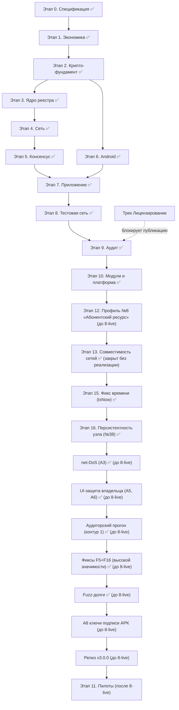

# План программирования платформы сетей доверия

Последовательность работ без привязки к датам. Основа — документ платформы v9.4 (разделы 3–19), в первую очередь дорожная карта раздела 19. Каждый этап имеет критерий готовности; следующий этап начинается, когда готов предыдущий (если не указано «параллельно»).

> **Обновлено 22.10.2026.** Этапы 0–10 и мини-этапы 11-й серии выполнены (этап 9 — аудит и решения владельца: `stage9-audit` — merge `53c4c2d`, мини-ветка `stage9-decisions` — merge `fad0dac`; этап 10 — модули и платформа профилей: ветка `stage10-profiles` слита в `main` — merge `9136772`, 20.10.2026, отчёт `reports/REPORT-STAGE-10.md`; спека v9.7). Зафиксированные параметры внесены по факту: K = 3, слоты 3/5/10, R = 10%, посевной круг ≥ 300 (этап 1); демередж 1% / 3000 периодов, комиссия rate ∈ [0.5; 2]%, P = 3000 / P_max = 30000 (этап 1.2); Snowball k = 10, α = 0.7, β = 4; epoch = 24 ч (№16), M = 21 (№17), seed_sunset = 100 active / 24 эпохи (№15), граница малых сетей ~100 участников (этап 5). Промежуточные релизы опубликованы: Zenodo 10.5281/zenodo.23474357 (equality-anti-farm-simulation), 10.5281/zenodo.23474316 (equality-trust-networks). Ветки: `stage6-android` (4e237bc) слита в `main`; `stage7-flutter` (c14ee0f..fcc0644) слита в `main` (merge `588dfed`, 20.10.2026; tip main `a673420`). Правило ветвления (20.10.2026): каждый этап — отдельная ветка от `main`; после подтверждения владельца CLI пушит ветку и вливает её в `main`. Чистка .gitignore (19–20.10.2026, `565f4bb` + `c8a1388`): глобальные шаблоны всех кешей и генератов (build/, .gradle/, .dart_tool/, .cxx/, captures/, local.properties, .idea/, *.iml, .vscode/, *.swp, .DS_Store, Thumbs.db, *.prof и др.); артефакты сборки (757 файлов, 191,5 МБ) были только staged, ни в одном коммите — история не переписывалась, обычные пуши. Подэтап 8.1 выполнен 20.10.2026 (ветка `stage8-1-simulation` слита в `main` — merge `7c37bd7`; tip main `b0fa7ba`): оба прогона, блокеры ANR/E_DUP закрыты, находки №39–№42. Мини-этап stage11-prep (формализация решений №44–№46, сверка спеки v9.8, эмуляторный прогон «кража → восстановление») выполнен и слит в `main` 21.10.2026 (merge владельца `932ca8b`; отчёт `reports/REPORT-STAGE-11-PREP.md`; 8 PENDING-находок — кандидаты в мини-ветку фиксов до `stage11-2-guardians`). Мини-этап stage11-1-fixes (фиксы находок прогона stage11-prep: low-s Keystore-подписей №1, окно челленджа UI заявляемого периода №2, nonce в StartMigration №5, флаг -migrate-delay-days №6) выполнен и слит 21.10.2026 (merge `53bda9c`; отчёт `reports/REPORT-STAGE-11-1-FIXES.md`). Мини-этап stage11-2-guardians (перевыбор личных гардианов `update_guardians` по спеке v9.8: окно 48 ч, отмена PIN-only, лимит 150 вступивших в силу смен; протокол+ядро, экран «Гардианы» и экран согласия, i18n ×5; эмуляторный прогон «публикация → отмена в окне → вступление в силу») выполнен и слит 21.10.2026 (merge `c59823e`; отчёт `reports/REPORT-STAGE-11-2.md`; PENDING 1–7 — кандидаты в следующую мини-ветку и блок 8-live). Мини-этап stage11-3-fixes (фиксы из PENDING stage11-2: №2 — периодический flush зрелых отложенных операций после рестарта узла, применяется после первичной сверки (settle «впереди» синхронизации ломал исторический демередж холодной сверки — поймано converge-тестом); №3 — таймаут биометрии не вешает UI, отмена диалога возвращает экран в рабочее состояние; №4 — History перезапрашивается после рестарта; №6 — hex-чанки по 20 с контролем длины/символов + контроль поля списка «новые гардианы» (находка прогона); №7 — клавиатура не перекрывает кнопки) выполнен и слит 22.10.2026 (merge `855737e`; ветка b7d25b8..c89a4d6, 3 коммита; отчёт `reports/REPORT-STAGE-11-3-FIXES.md`; скриншоты reports/stage11-3-fixes/01–31; flutter test 43/43, go test + race по задетым зелёные). PENDING №1 (семантика подписи гардиана — решение владельца, до пилотов) и №5 (способ сдвига часов для прогонов — вне кода) остаются открытыми. Этап 12 добавлен 27.10.2026 (решения владельца по профилю №8 «Абонентский ресурс»: recurring-единицы с периодной меткой и сгоранием, само-сертифицирующийся network_id, зарезервированный network_id "global" для глобальной сети, genesis-валидация комбинаций; внести в спеку, код и документацию). Порядок (решение владельца 27.10.2026): этап 12 реализуется до блока 8-live. Этап 13 добавлен 31.10.2026 (решение владельца): понять, как разные сети могут быть совместимы, и добавить слияние сетей в документацию. Этап 13 закрыт 02.11.2026 решением владельца: слияние сетей НЕ реализуется — дизайн (`docs/network-merge-design.md`) прошёл независимый аудит (ветка `audit`, вердикт «Переработать»), владелец решил не реализовывать вовсе; изоляция сетей (раздел 3.1 спеки) — постоянное правило платформы. Этап 15 (фикс времени, A7) выполнен 02.11.2026 и слит merge `cdb910d` — секция этапа 15 ниже. Этап 16 (персистентность узла приложения, №38, SQLite/SIGSYS) выполнен 02.11.2026 и слит merge `c419c2a` — секция этапа 16 ниже; порядок после этапа 15, подтверждён владельцем: net-DoS (A3) → UI → fuzz → A8 → A9 → A10. Тема net-DoS (A3) добавлена 02.11.2026: промпт `prompts/net-dos-a3-prompt.md`, ветка `net-dos-a3` — секция ниже; тема выполнена 02.11.2026 и слита merge `18edf02`. Тема UI-защиты владельца (A5, A6, PIN-лимит, FLAG_SECURE, кодировки надписей) добавлена 02.11.2026: промпт `prompts/ui-owner-protection-prompt.md`, ветка `ui-owner-protection` — секция ниже; тема выполнена 02.11.2026 и слита merge `84bf387` (CI-verify 5/5 зелёные; отчёт `reports/REPORT-UI-OWNER-PROTECTION.md`). Тема Аудиторский прогон контура 1 (ширина) добавлена 02.11.2026: промпт `prompts/audit-frontier-pass-prompt.md`, ветка `audit-frontier-pass` (только чтение + reports/) — секция ниже; тема выполнена 02.11.2026 и слита merge `bce8773` (только чтение, в merge — только reports/; 24 FINDING: 2 высокой, 9 средней, 13 низкой; отчёт `reports/REPORT-AUDIT-FRONTIER-PASS.md`). Тема Фиксы F5 и F16 (находки аудита контура 1 высокой значимости: подменной адрес приманки, офлайн-финальность) добавлена 02.11.2026 (решение владельца: обе находки высокой значимости — одной темой, до fuzz): промпт `prompts/fix-f5-f16-prompt.md`, ветка `fix-f5-f16` — тема выполнена 02.11.2026 и слита merge `169f12c` (CI-verify зелёный; FINDING эмуляторного прогона — кэш `AppState._address` — закрыт в ветке `317d53d`; отчёт `reports/REPORT-FIX-F5-F16.md`) — секция ниже. Релиз v3.0.0 — после A10 и перед блоком 8-live (решение владельца 02.11.2026, секция ниже). Тема Fuzz-долги (fuzzing и property-based тесты: wire-кодек, ASN.1, core/store, сверка proto, инварианты ядра) добавлена 02.11.2026, выполнена 03.11.2026 и слита merge `d5d3e86` (исполнитель DeepSeek V4.1 Flash 1017, A/B-прогон GLM 5.3 — ветка `fuzz-debts-ab`; blind-аудит GLM 5.3, thinking max — ветка `audit-fuzz-debts`, tip `fc37e29`, отчёт перенесён в main `53ca5a8`: вердикт «готова к merge», 0 расхождений; FINDING-1 — недоверенный ввод вне минимум-списка мандата — отдельная тема-долг) — секция ниже. Тема A8 — ключи подписи APK (боевая release-подпись: единый std + отдельный rec) добавлена 03.11.2026: промпт `prompts/a8-keys-prompt.md`, ветка `a8-keys` — секция ниже.

---

## Этап 0. Спецификация протокола — ✅ выполнено

Формализовать документ до вида, по которому можно писать код и те
сты.

- [x] Wire-формат всех транзакций (раздел 9.3): protobuf-схемы, поля `wallet`, `seq`, `prev`, `type`, `payload`, `timestamp_claim`, `protocolVersion`, подпись.
- [x] Формат genesis-пакета и манифеста сети (разделы 3.3, 4): схема полей, хеш манифеста, `mutable_bounds`, посевной круг.
- [x] Правила проверки каждого типа транзакции каждым узлом — таблицы «условие → принять/отклонить» для всех типов ядра.
- [x] Инварианты ядра (раздел 3.2) как проверяемые утверждения INV-1..14.
- [x] Тестовые векторы: корректные транзакции, эквивокация, двойной выпуск, мораторий, окно накопления.
- [x] Черновик машины состояний кошелька: `registered → active → expired`, метка `flagged`, слоты поручителя.

**Готовность:** ✅ спецификация v1 с тестовыми векторами (`spec/` 00–07, `proto/`, `vectors/` — 20 векторов, `QUESTIONS.md`).

**Открытые вопросы, закрытые здесь:** формат чекпоинта ✅ (`spec/07`); схема пороговой подписи ✅ — N-из-M из набора подписей ECDSA P-256 (не BLS).

---

## Этап 1. Параметры сети: экономика и защита от ферм

### 1.1 Экономика поручительств и фермы — ✅ выполнено

Реализовано и опубликовано: репозиторий `equality-anti-farm-simulation` (Python, агентная модель):

- честный рост через поручительства: K, слоты 3/5/10, возраст поручителя ≥ 3 мес., слот освобождается после 3 выпусков поручаемого или 3 мес. без активации;
- ферма: покупка устройств, проникновение к честным поручителям, рост кольцом взаимных поручительств;
- экономика фермы: стоимость устройства и электричества, утечка 10% выпуска первым 12 периодам поручителям; главная метрика — безубыточная цена единицы;
- прогнанные сценарии: K = 2–5, узкие и щедрые слоты, проникновение 0–20 кошельков/мес., посевной круг 50–1000, бюджет фермы 5–100 устройств/мес.

Что осталось по этой модели:

- [x] Зафиксировать выбор K, S, R отчётом по результатам прогонов (раздел 17). ✅ Зафиксировано: K = 3, слоты 3/5/10, R = 10%, посевной круг ≥ 300 — обновлён раздел 7.7 KNOWLEDGE.md (v9.2) и таблица раздела 17.
- [ ] Калибро
вка допущений честного роста на реальном сообществе (закроется первым пилотом профиля 1).
- [ ] Расширить ту же модель: демередж, комиссия, мораторий на вывод — сейчас не моделируются.

### 1.2 Параметры — ✅ закрыты (отчёт 1.2, equality-anti-farm-simulation/Mistral/REPORT.md, раздел 5)

- [x] P и `P_max` отложенного перевода (раздел 8.3, вопрос 4 раздела 18) — **P = 3000, P_max = 30000**.
- [x] Демередж для профилей 5 и 7 — **1% / 3000 периодов**.
- [x] `fee_min`, границы `[rate_min, rate_max]`, целевой рост предложения — **адаптивная rate ∈ [0.5; 2]%, fee_min = 0.01**.

Значения реализованы в `core/params` (этап 3); туда же — окно переводимости свежих выпусков 3 мес. (`fresh_transfer_window_periods`, вопрос №11).

### 1.3 Симуляция реестра и консенсуса — перенесена в этап 5, выполнена там ✅

Конфликты, эквивокация, двойной выпуск, потеря связности, голосование и чекпоинты на сотнях узлов — это симуляция протокола, а не экономики. Выполнена в Go headless-ядре как «проверка до реализации» (раздел 9.1) в этапе 5.

**Готовность этапа 1:** ✅ K/S/R подтверждены отчётом; демередж, комиссия и P выбраны прогонами расширенной Python-модели.

---

## Этап 2. Криптографический фундамент ядра — ✅ выполнено (подэтап 3.0, ветка stage3-core)

- [x] Подписи ECDSA P-256 (`crypto/ecdsa`); фиксация формата ключа и адреса (`walletFingerprint`).
- [x] PoW: лёгкий (на `transfer`) и memory-hard на базе Argon2id (`x/crypto/argon2`) для `register` и выпуска; параметры под средний телефон — таргеты финализируются замерами на устройстве (этап 6, вопрос №9).
- [x] Sparse Merkle-дерево состояния (балансы + `seq`): построение, включение, доказательства для лёгких узлов.
- [x] Пороговая подпись чекпоинтов: N-из-M из набора подписей ECDSA P-256 (решение этапа 0), режимы `decentralized` и `members_quorum`.
- [x] Разбор цепочки аппаратной аттестации Android через `encoding/asn1`: синтетические корни для тестов; реальные цепочки Google, `verifiedBootState`, `deviceLocked`, уровень патча — на живом ус
тройстве в этапе 6 (№23 → вопрос 7).

**Готовность:** ✅ все криптопримитивы ядра покрыты тестами, включая векторы аттестации (синтетические; реальные — этап 6).

---

## Этап 3. Ядро реестра (без сети) — ✅ выполнено (ветка stage3-core, c7e7df1; отчёт core/REPORT-stage3.md)

- [x] SQLite-хранилище (раздел 12.5): цепочки, индекс «фингерпринт → адрес», данные лёгкого узла, заголовки чекпоинтов.
- [x] `register`: аттестация + усиленный PoW, один фингерпринт = один адрес, запрет второго кошелька на уровне приложения.
- [x] `vouch`: K поручительств, возрастной порог, пул слотов по возрасту, освобождение слота.
- [x] `mint`: `periodic_equal`, `period − 1` при первом, окно накопления 6 мес., челлендж в рандомном слоте ±48 ч, доля R поручителям из первых 12 выпусков.
- [x] `transfer`: сжигаемая комиссия (адаптивная `rate` на границе эпохи), мораторий 14 дн., отложенные крупные переводы (порог P, задержка D = 48 ч, отмена, повышение P через 48 ч).
- [x] Демередж: детерминированный эффективный остаток, без транзакций списания.
- [x] `evidence`: закрытый перечень (эквивокация, двойной выпуск), мягкие последствия — метка `flagged`, приостановка выпуска, прекращение доли поручителям.
- [x] `migrate` и гардианы: личные 2 из 3, публичные 3 из 5, задержка 14 дней и отмена, перенос возраста и истории, чёрный список фингерпринтов, лимит G_max.
- [x] Смена параметров (`params_mutable`): предложение → окно подписей → порог ≥ 2/3 → задержка ≥ 30 дней → активация в эпоху; неретроактивность; сборка форк-пакета одной командой.
- [x] Fuzzing и property-based тесты на инварианты ядра из этапа 0.

**Готовность:** ✅ ядро проходит полный набор тестов спецификации (12/12 векторов, property-поток 400 операций с INV, метаморфные мутации, сквозной сценарий, сеттлемент).

---

## Этап 4. Сеть (go-libp2p) — ✅ выполнено (ветка stage4-network, 7853874; отчёт reports/REPORT-STAGE-4.md)

- [x] Транспорт QUIC/TCP, Noise, DHT (Kademlia), GossipSub.
- [x] Bootstrap-каскад (раздел 12.3): кэш пиров → подписанн
ые seed-списки → зашитый список в APK → NSD/mDNS → Bluetooth-скан → QR → ручной ввод; peer exchange.
- [x] Hole punching и circuit relay через добровольные полные узлы (CGNAT) — DCUtR + circuit relay v2, эмуляция в тестах.
- [x] Уровни узлов (раздел 12.2): полный / лёгкий, переключение по условиям (зарядка + Wi-Fi).
- [x] `invite_only`-сети: ключ сети в приглашении (QR/ссылка), фильтрация пиров по `network_id`.
- [x] Защита от eclipse: смешивание источников, подтверждение от N несвязанных пиров (№35: Peer ID — сделано; подсети/ASN — этап 6); тест изоляции узла.
- [x] Bluetooth-канал (раздел 12.4): SideChannel — прямая передача подписанной транзакции, статус «ожидает публикации», проверка `seq`/`prev` при публикации.

**Готовность:** ✅ headless-узлы на разных машинах синхронизируют реестр; eclipse-тест пройден.

---

## Этап 5. Консенсус: голосование, чекпоинты, эпохи — ✅ выполнено (ветка stage5-consensus, локальная; отчёт reports/REPORT-STAGE-5.md)

Зафиксировано симуляцией и утверждено 18.10.2026: Snowball k = 10, α = 0.7, β = 4, веса по возрасту + аттестации; №16 epoch = 24 ч; №17 M = 21; №15 seed_sunset = 100 `active` / 24 эпохи; граница малых сетей `members_quorum` — ~100 участников.

- [x] Выборочное голосование: повторяющийся опрос выборки пиров, веса по возрасту и аттестации кошельков.
- [x] Чекпоинты: подписанный пороговой подписью корень состояния, режимы `decentralized` / `members_quorum`, переходный режим посевного круга с расписанием `seed_sunset`.
- [x] Сетевое время (раздел 9.2): эпохи как источник правды, допуск timestamp ±30 мин, предел сдвига между чекпоинтами.
- [x] Симуляция на сотнях виртуальных узлов (требование раздела 9.1): все 8 сценариев, детерминированная по seed.

**Готовность:** ✅ финальность 4 раунда (= β) во всех агрессивных сценариях; злонамеренные до 30% — честная ветка побеждает; поведение при разделении задокументировано; граница малых сетей определена; чекпоинты подписываются во всех трёх режимах; лёгкий узел проверяет доказательст
во по чекпоинту.

---

## Этап 6. Android-платформа (Kotlin + связка с ядром) — ✅ выполнено (ветка stage6-android, 4e237bc, слита в main; отчёт reports/REPORT-STAGE-6.md)

Можно начинать после этапа 2, параллельно этапам 3–5: проверка Keystore и аттестации на устройствах не зависит от сети. Фактически выполняется после этапа 5: ветка `stage6-android` от `stage5-consensus`. Промпт: `prompts/stage-6-prompt.md`.

- [x] **Подэтап 6.0 — долги:** подпись ответов голосования в сети (cons/net, долг этапа 5); несвязанность eclipse-пиров по подсетям/ASN (№35, хвост этапа 4); закрепление утверждённых №15/№16/№17 и границы малых сетей в `QUESTIONS.md` и params/genesis.
- [x] Интеграция ядра: `gomobile bind` (AAR) или `c-shared` + `dart:ffi` — выбрать по замерам; foreground service, platform channels, protobuf-обмен.
- [x] Keystore: ключевая пара с `setAttestationChallenge`, `setUserAuthenticationRequired(true)` на каждую операцию, `setInvalidatedByBiometricEnrollment(true)`, `BIOMETRIC_STRONG`.
- [x] Подтвердить на целевых устройствах: ECDSA P-256 везде, поддержка Ed25519, разбор расширения аттестации (вопрос 7 раздела 18).
- [x] Экран биометрии: отказ в регистрации без настроенной биометрии, системный экран добавления отпечатка.
- [x] PIN: обычный и тревожный (раздел 8.2), неразличимость, отключение входа по отпечатку при включённом тревожном, режим-приманка без использования ключа подписи.
- [x] `allowBackup=false`, получение актуального `seq` от нескольких пиров перед подписью.
- [x] Bluetooth-передача транзакции, NSD/mDNS-обнаружение для локальной Wi-Fi-сети.
- [x] Замеры ресурсов (раздел 12.1): размер сборки, память, энергия, DHT в клиентском режиме; лёгкий режим узла; финализация таргетов PoW №9.

**Готовность:** ✅ AAR (`gomobile bind`) собран и связан с ядром: регистрация, подпись, проверка транзакций; Keystore + BIOMETRIC_STRONG, PIN, аттестация, замеры зафиксированы (reports/REPORT-STAGE-6.md). Живой телефон — чек-лист reports/stage6/ (PENDING, не блокер).

---

## Эта
п 7. Приложение (Flutter) — ✅ выполнено (ветка stage7-flutter, c14ee0f..fcc0644, слита в main merge 588dfed 20.10.2026; отчёт reports/REPORT-STAGE-7.md, скриншоты reports/stage7/01–17)

- [x] Онбординг: создание кошелька, обязательное предложение гардианов при создании, настройка биометрии.
- [x] Поручительства: QR и Bluetooth при личной встрече, статус кандидата, слоты.
- [x] Кошелёк: баланс, история, выпуск с челленджем, переводы, отложенные переводы с отменой, Bluetooth-платёж со статусом «ожидает публикации».
- [x] Реестр и репутация: публичная история, возраст, глубина графа поручительств, статистика поручителя.
- [x] Миграция: запуск, отмена, публичные гардианы, перезапуск с новыми поручительствами.
- [x] Интерфейс режима-приманки: правдоподобный остаток и история, «ожидает подтверждения».

**Готовность:** ✅ полный путь в эмуляторе: регистрация → гардианы → vouch×3 (V1..V3) → `ACTIVE` → выпуск 1000 → 901 (доля поручителей R ≈ 9,9%) → перевод 50 + комиссия 1 → 850; история, миграция, QR, Bluetooth-канал — экраны готовы (reports/stage7/01–17). Живой телефон и Bluetooth-платёж — чек-лист отчёта (PENDING). go test 10/10 (+race), flutter analyze/test — чисто.

---

## Этап 8. Закрытая тестовая сеть — ✅ выполнено 20.10.2026 (ветка `stage8-testnet` слита в `main` — merge `7271b34`; отчёт `reports/REPORT-STAGE-8.md`)

Промпт: `prompts/stage-8-prompt.md`.

**Ограничение (19.10.2026):** у владельца нет Android-устройства (iPhone). Весь код, утилиты и ранбук пишутся и проверяются в эмуляторе; всё, что физически требует живого Android-телефона, — отложенный блок 8-live (не блокирует этап 9).

- [x] **Подэтап 8.0 — долги этапа 7 закрыты:** слот mint считается от genesis-времени (календарные периоды 9.2, вопрос 18), тесты добавлены; `SkipMintChallengeWindow` → false (окно M7 проверяется при apply, реальное окно ±48 ч проверено на тестнете в обе стороны); syncLoop — диагноз: первый проход шёл до identify пира, ошибка глоталась; фикс — сверка журнала по событию identify; №38 
— узел in-memory (SQLite на живом телефоне — блок 8-live); Fee = RateMin — не трогали (полная комиссия — этап 10).
- [x] Genesis-утилита `cmd/tnp-testnet`: генерация genesis-пакета/манифеста/seed-списка/приглашений (invite_only, параметры KNOWLEDGE 4/17) + декодер genesis-пакета (аддитив) + tx-драйверы; сборка сети проверена в эмуляторе: узлы из genesis-файла + приложение (журнал 11 tx синхронизирован).
- [x] Release-APK: R8 + debug-подпись, 163,5 МБ, установка и запуск в эмуляторе чистые; живые устройства — блок 8-live.
- [x] Ранбук `reports/stage8/TESTNET-RUNBOOK.md` — написан целиком с пометкой «к прогону после появления Android-устройств (блок 8-live)».
- [x] Эмуляторный прогон (артефакты + скриншоты reports/stage8/01–09): окно челленджа (accept в окне / E_POW_HARD вне), эквивокация → conflict-ветка → `evidence` → `flagged` → E_VOUCH_FLAGGED, отложенный перевод 3500 с отменой, комиссия, vouch (±E_VOUCH_PERIODS), миграция propose+cancel, холодный старт с нуля; приложение: онбординг с биометрией → vouch×3 → `ACTIVE` → выпуск 901 → перевод 850 → тревожный PIN (приманка 847, возврат к реальному кошельку).
- [x] Тесты и CI: `go test ./...` зелёный, race `net/query` зелёный, `flutter analyze`/`test` чисто; CI обновлений не потребовал.

**Отложено — блок 8-live (до появления Android-устройств):** установка APK на живые устройства, разные производители/версии; Bluetooth-платёж и Bluetooth-vouch; аттестация на реальном железе; SQLite на живом телефоне (№38); посевной круг из нескольких живых людей; тест принуждения на живом устройстве; замеры ресурсов; NSD/mDNS в реальном Wi-Fi.

**Готовность:** ✅ выполнено 20.10.2026 — все пункты закрыты; блок 8-live зафиксирован в отчёте как отложенный. Живые прогоны — критерий блока 8-live (не блокирует этап 9; блокирует этап 11 — пилоты).

**Находки этапа 8:** №39 (новый, ждёт решения владельца): при буквальной семантике окно челленджа достижимо лишь для ~1/15 слотов — требуется решение о якоре слота; №40 (новый, кандидат в этап 9): 
`cons.Replay` пинирует только NetTime → демередж при пересчёте из БД расходится с холодной синхронизацией (Δ125, root A/B ≠ C); PinManager-баг (исправлен): с заданным тревожным PIN приложение блокировалось навсегда — латентно с этапа 6, вскрыто прогоном; `cmd/tnp-node` отсутствовал в git (паттерн .gitignore) — исправлено.

---

## Подэтап 8.1 — масштабная симуляция: 50 узлов — ✅ выполнено 20.10.2026 (ветка `stage8-1-simulation` слита в `main` — merge `7c37bd7`; отчёт — раздел «Симуляция 50 узлов» в `reports/REPORT-STAGE-8.md`; артефакты `reports/stage8/sim50/`; промпт `prompts/stage-8-1-prompt.md`)

Цель — проверить поведение сети и приложения при посевном круге в 50 участников на одном ноутбуке владельца (16 ГБ RAM + 7 ГБ подкачки). Bluetooth не используется (и так блок 8-live).

**Ограничение:** 50 эмуляторов QEMU нереально — один эмулятор съедает ~4 ГБ RAM (фактический замер прогона этапа 7: посевной круг V1–V3 внутри одного эмулятора). Рабочая схема: **48 headless Go-узлов (`tnp-node`, ~12 МБ на узел — замер этапа 8; всего <1 ГБ) на localhost + 2 эмулятора с реальным Flutter-приложением (по ~3,8 ГБ RAM на эмулятор — замер этапа 8)**. Уточнение 20.10.2026: цифры «2,6 ГБ» (QEMU) и «2,9 ГБ» (CLI) в таблице процессов — суммарное чтение с диска, НЕ своп; реальный бюджет 8.1: 2×3,8 (эмуляторы) + ~1–2 (48 узлов с состоянием) + 0,7 (CLI-агент) + ~0,5–2 (рабочий стол) ≈ **~10–13 ГБ RAM — влезает в 15,1 ГиБ практически без свопа** (наблюдаемые 4,1 ГиБ свопа — вероятный след сборочных пиков Gradle, не устойчивая потребность). Перед прогоном остановить Gradle-демоны (−3,1 ГБ RAM) и закрыть браузер (−2,3 ГБ RAM). Замер CPU прогона этапа 8: один эмулятор ~20% ядра — CPU не узкое место (запас ~5 ядер из 8); диск эмулятора за прогон: чтение ~2,6 ГБ + запись ~4 ГБ. Порядок запуска: сначала headless-узлы и связность, потом эмуляторы. Если тормозит — сокращать headless-узлы (50→40→30) или оставить 1 эмулятор.

- [x] Seed-режим через `cmd/tnp-testnet`: тестовый genesis — малые PoW-
таргеты (как тестовые окружения этапа 6), seed-список, параметры из KNOWLEDGE 4/17. **Два прогона с разными эпохами** (длина эпохи — параметр `epoch_seconds`, влияет на достоверность периодной механики, не на нагрузку): (1) флот 48 headless-узлов без эмуляторов, эпоха 1–2 мин (~30–40 мин прогона) — связность, throughput, финальность, чекпоинты; (2) полный прогон с 2 эмуляторами, **эпоха 5 мин (~2–2,5 ч)** — периодная механика в осмысленном масштабе: операция ≪ эпоха (PoW 10–20 с — до ~4% эпохи, как в продакшене ~0,02%), UI-путь участника не пересекает несколько периодов, окна челленджа и M4 проверяются по логике, а не случайно; 24 эпохи `seed_sunset` проходят за ~2 ч. Итоговая длительность ~3 ч.
- [x] Полный путь 50 участников: регистрация, vouch, минты в окне челленджа, переводы (обычный, отложенный с отменой), комиссия, демереж, миграция, тревожный PIN.
- [x] **Требование безопасности UI (решение владельца 20.10.2026):** перевод и все деструктивные операции (выпуск, миграция propose, смена/удаление PIN) — только явный ввод PIN (реального или тревожного); вход — отпечаток или PIN; биометрия — только для разблокировки/просмотра; сохраняется правило этапа 6 (раздел 8.2): при включённом тревожном PIN вход по отпечатку отключён — PIN-only и на входе, иначе приманку обходят на входе силой. Принцип: PIN-промпт — точка входа в режим-приманку; биометрия принуждаема физически (палец прикладывают силой), PIN-ввод сохраняет жертве выбор. Убрать биометрическое подтверждение с экрана перевода и всех деструктивных экранов; тест: перевод требует PIN, тревожный PIN на экране перевода открывает приманку, после переводов и рестарта тревожный PIN жив. Формулировка в спеку (раздел 8.2) — этап 9; реализация PIN-only на деструктивных экранах и тесты — этап 9 (аудит защиты владельца).
- [x] `seed_sunset`: при 50 узлах сработает только ветка «24 эпохи» (порог 100 active недостижим); чекпоинты O(N) на границе `members_quorum` ~100 — зафиксировать метрики.
- [x] Наблюдение за эмуляторами с 
приложением в толпе (регистрация, выпуск, перевод при 50 узлах).
- [x] Тесты и CI не ломаются; результаты и метрики — в `reports/REPORT-STAGE-8.md` (раздел «Симуляция 50 узлов»).
- [x] **Уборка процессов (после каждого прогона):** остановить Gradle-демоны и завершить оставленные процессы (`tnp-node`, `tnp-testnet`, `qemu-system-x86_64`) — они переживают запуск и накапливаются; перед стартом следующего прогона убедиться, что старых нет (`pgrep`).

**Итоги 8.1 (20.10.2026):** прогон 1 (SQLite, эпоха 90 с): 48 узлов, RSS 46–61 МБ (мед. 52→57); прогон 2 (память, эпоха 5 мин): эра 1 — журнал 143 tx, 50 ACTIVE, seed_sunset (эпохи 1–23 строит node29, с 24 — decentralized-выборка); эра 2 — минты P=3 28/28 (№39 подтверждён: окна у якоря, вне окна E_POW_HARD, UI блокирует), демередж S81 5000→5178 (floor 3000, −20 граница, +198 поручителям), наблюдатель-узел 49 холодной сверкой — root идентичен, перевод 50 принят (100→49, комиссия 1 сожжена), журнал 172, state_root `1d9d76c6…b48a3`; повтор эры 2 (инцидент рестарта сессии) воспроизвёл root детерминированно. Чекпоинты при 50 участниках: 14 подписей ≤40 с; LinkGroups=false подтверждён (прод-дефолт включён). **Блокеры закрыты:** ANR — весь cgo off-main (рестарт-тест чист, tid≠pid, 0 E_DUP), E_DUP — дедуп txid в gossip до apply. **Открыто в этап 9:** №40 — старт-блокер (store-replay из БД: E_VOUCH_EPOCH ×96; временный путь — `net.ImportJournal`), №41 — инкрементальный якорь сверки, №42 — `cpEpochOverdue` при выпадении детерминированного строителя (600 с при эпохе 300 с), реализация PIN-only, формализация 8.2/№39 в спеку.

**Готовность:** ✅ выполнено 20.10.2026 — seed-режим утилитой этапа 8; 48 headless-узлов + 2 эмулятора одновременно на ноутбуке владельца; полный путь 50 участников пройден; метрики в отчёте; процессы убраны (`879b87e`).

---

## Этап 9. Аудит — ✅ выполнено 20.10.2026 (ветка `stage9-audit` слита — merge `53c4c2d`; мини-ветка `stage9-decisions` слита — merge `fad0dac`; отчёт `reports/REPORT-STAGE-9.md`; промпт `prompts/stage-9-prompt.md`)

- [x] Независимый аудит криптографии (подписи, PoW, Merkle, пороговые подписи): маллеабельность ECDSA закрыта — каноничный DER + low-s (`09738c0`, регресс-тест `93bada0`); новых критичных находок нет.
- [x] Аудит консенсуса (голосование, чекпоинты, eclipse): три гонки (Snowball, `cons.Clock`, cheapCheck/StateRoot) закрыты (`9be07ac`), race 20 → 0; CI android — AGP 8.9.1 (`2079bc6`).
- [x] Аудит разбора аттестации и защиты владельца (тревожный PIN, отложенные переводы): новых критичных находок нет; тайминговая различимость режима-приманки зафиксирована в отчёте честно.
- [x] Исправления и повторная проверка критических и высоких находок: №40 — пинирование Epoch/Period при Replay из БД (`353a742`, `b9a02ab`); №41 — позиционный якорь `SyncJournalFrom` (`4ce411d`, `be82cf4`); PIN-only на деструктивных экранах приложения (`186d18c`); спека v9.5 (`6c504ae` — раздел 8.2 + якорь слота №39); отчёт `reports/REPORT-STAGE-9.md` (`63d8060`).
- [x] **Скоуп подтверждён владельцем 20.10.2026 (закрытие блокеров 8.1):** №40 — пинирование Epoch/Period при Replay из БД в `cons/` (сходимость store-replay с холодной синхронизацией, state_root A=B=C, расхождение демереджа Δ125 закрыто, регресс-тесты рестарта из БД; `net.ImportJournal` остаётся путём восстановления); №41 — инкрементальный якорь `SyncJournalFrom` (позиционный after — сверка не квадратична по трафику); №42 — семантика `cpEpochOverdue` при выпадении детерминированного строителя чекпоинта (варианты с трейдоффами — `QUESTIONS.md`, решение владельца, протокол не менять до решения); реализация PIN-only на деструктивных экранах приложения + тесты; формализация в спеке v9.5 — раздел 8.2 (правила безопасности UI) и якорь слота №39. Промпт: `prompts/stage-9-prompt.md`.
- [x] **Решения владельца — мини-ветка `stage9-decisions` (3 коммита, merge `fad0dac`, 20.10.2026):** №39 ✅ — якорь слота — календарные периоды от genesis; №42 ✅ — (A) очередь строителей (первые K участников состава, ротация epoch/2, genesis-поле `cp_builder_queue`) + (D) пропуск застрявшей эпохи (пустой гэп нумерации; подписанты принимают last+2 только при исчерпанной очереди), спека v9.6 «пустая эпоха» (`91c2154`); №43 ⏳ — отзыв аттестации (CRL/OCSP) отложен для v1 (пересмотр при реальных корнях / блоке 8-live), минор-фикс «будущая дата патча» принят; 5 новых тестов + 2 устранённых флака; `go test ./...` и `-race` чистые.

**Готовность:** ✅ выполнено 20.10.2026 — отчёт аудита (`reports/REPORT-STAGE-9.md`), критические и высокие находки закрыты и перепроверены; №40/№41 реализованы; №39 и №42 решены владельцем (якорь слота от genesis; очередь строителей + пропуск пустой эпохи (A)+(D), спека v9.6); №43 отложен для v1. Промежуточные релизы (Zenodo, GitHub) уже опубликованы по решению пользователя; дальнейшие публикации и продвижение — после трека «Лицензирование».

---

## Этап 10. Модули и платформа профилей — ✅ выполнено 20.10.2026 (ветка `stage10-profiles` слита в `main` — merge `9136772`; отчёт `reports/REPORT-STAGE-10.md`)

Промпт: `prompts/stage-10-prompt.md`.

- [x] **Адаптивная комиссия (долг 8.0):** замена заглушки `Fee = RateMin` детерминированным пересчётом `rate` на границе эпохи из данных чекпоинтов (раздел 10.2 спеки; rate ∈ [0.5; 2]%); genesis-поля 57–59 (`fee_adjust_epochs`, `fee_target_growth_micros`, `fee_step_micros`), источник — `total_supply` финализированных чекпоинтов, рестарт из БД (тест эквивалентности), `fee_mode = POOL` — общий фонд; параметры пересчёта — черновые дефолты, №44 (этап 11).
- [x] `attest` + проверяющая библиотека (Go; сборки JVM и JS — №45, этап 11): подпись кошелька, Merkle-доказательство из чекпоинта, `challenge`, срок годности, `H(address ‖ app_id)`; лёгкий клиент-синхронизатор — `core/present` (Verify + LightSync): верификатор проверяет предъявление без полного узла.
- [x] `redeem`: погашение с `resource_id`, квоты `quota_reset`, подписанные `receipt` (payload-теги 17–24).
- [x] `pool`: `pool_create/donate/close/claim`, режимы выпуска, возврат.
- [x] `contribution`: `contribution_claim/confirm`, подтверждения `peer`, лимиты, потолки, выплата из пула (числа — константы `core/ledger/modules.go`, №46 — этап 11).
- [x] `sandbox`: синтетические кошельки, headless-режим, экспорт реестра для анализа (json/csv, режим `export` в `tnp-testnet`).
- [x] Конфигуратор сети: выбор шаблона профиля, параметры, genesis-пакет + приложение, вычисление уровня гарантий из манифеста (`tnp-testnet configure`, `guarantees.json`).
- [x] **Локализация UI кошелька (i18n, Flutter):** состав подтверждён владельцем 20.10.2026 (№47 решён) — русский (ru), английский (en), испанский (es), португальский (pt), китайский мандаринский (zh); все пять реализованы полностью (`flutter_localizations` + `intl`, ARB-каталоги, ~200 ключей, 13 экранов + описание истории), fallback — английский; фарси и иврит при включении — RTL-разметка; приоритет — языки сообществ первых пилотов (этап 11, порядок раздела 16.4).
- [x] **Карточка восстановления (решение владельца 20.10.2026):** при создании кошелька экран «сохраните эти данные» — адрес кошелька, адреса назначенных гардианов, название сети + QR-код карточки (экспорт/печать) — с объяснением и напоминанием: данные миграции никому не передавать; доступна позже (настройки, экран миграции); формализована в спеке v9.7 (раздел 11); тесты.
- [x] Шаблоны семи профилей (раздел 5) и их валидация (например, запрет `relaxed` при высоких ставках) — `core/profiles`, все семь шаблонов генерируют валидные genesis-пакеты.

**Готовность:** ✅ выполнено 20.10.2026 — конфигуратор создаёт сеть-инстанс по шаблону (7 шаблонов, валидация, уровень гарантий из манифеста); верификатор проверяет предъявление в стороннем приложении (`core/present` + LightSync); адаптивная комиссия детерминирована (заглушка `Fee = RateMin` удалена, тесты эквивалентности); `attest`/`redeem`/`pool`/`contribution`/`sandbox` реализованы с тестами; i18n — все пять языков полностью; карточка восстановления с тестами; спека v9.7 (карточка — раздел 11); фикс гонки `cpTick`/`rebuildToFinality` (`d25af35`); находки №44–№46 — PENDING (этап 11), №47 решён; `go test ./...` и `-race` зелёные, `flutter analyze`/`test` чисто (22 теста); коммиты этапа `0fc57d3`..`cc0301e` (17 коммитов), merge `9136772`.

---

## Этап 11. Пилоты по профилям

Порядок юридического риска (раздел 16.4): **1 → 2 → 3 → 6 → 5 и 4 → 7**. Каждый пилот — отдельная сеть-инстанс в существующем сообществе.

- [ ] Профиль 1: лаборатория в образовании (песочница, локальный Wi-Fi).
- [ ] Профиль 2: доказательство человечности — первый сторонний потребитель с верификатором.
- [ ] Профиль 3: равные квоты.
- [ ] Профиль 6: учёт вклада.
- [ ] Профили 5 и 4: внутренняя валюта / волонтёрская программа — после юр. проверки профиля 5.
- [ ] Профиль 7: касса взаимопомощи — после юр. проверки сбора средств.

**Готовность платформы:** каждый профиль имеет хотя бы один реальный пилот (требование раздела 2.3).

---

## Этап 12. Профиль №8 «Абонентский ресурс»: recurring-единицы и идентификация сети — ✅ выполнено 01.11.2026 (мини-этапы слиты в main: merge `2c721f3` (recurring-ядро), `b73b224` (12.1), `1e47bf5` (12.2), `b799b50` (12.3); спека v9.11; мини-тестнет слит merge no-ff `d83ca16`, 01.11.2026)

Решения владельца 27.10.2026 (6 пунктов). Промпт: `prompts/stage-12-prompt.md` (создать перед запуском). Ветка: `stage12-recurring` от свежего `main`. **Порядок (решение владельца 27.10.2026): этап 12 реализуется до блока 8-live** — эмулятора достаточно, живые Android-устройства не требуются; изменения genesis (`network_id`, деривация адреса №2) желательно внести до первых живых прогонов на реальном железе. Мотивация: организатор привязывает к единице повторяющийся ресурс (процессорное время, дисковое пространство по абонентской плате); бизнесу невыгодно перетекание остатка в новый период. Это коммерческий сценарий — триггер коммерческой лицензии.

- [x] **Спека v9.10 → v9.11 (docs/KNOWLEDGE.md + ENG, построчные правки):** `recurring` как периодная метка на единицах — каждая выпущенная единица несёт `period`, перевод единицы периода P отвергается после границы периода P+1 (не сброс баланса: история остаётся публичной и проверяемой); по умолчанию `recurring = off`; `network_id = H(manifest ‖ genesis)` (само-сертифицирующийся, нельзя застолбить/подделать) + человекочитаемый `slug` как метка, не идентичность; зарезервированная константа `network_id = "global"` для глобальной сети (участвует в подписи и валидации всегда — защита от replay между сетями); genesis-валидация комбинаций: `recurring = on` только при не-глобальном `network_id` И `unit = quota(resource_id)` И `transfer_mode ∈ {restricted, peer-redeem}` (в глобальной сети recurring запрещён — нет организатора, определяющего период); восьмой сценарий — профиль №8 «Абонентский ресурс» (развитие профиля 3: подписка → равная квота за период → сгорание → передача квоты участниками → погашение поставщиком через `redeem`); changelog v9.10.
- [x] **Код:** genesis-поля (`recurring`, `slug`, деривация `network_id`), genesis-валидация допустимых комбинаций, правило сгорания по периодной метке в валидации `transfer`/`redeem` у каждого узла, шаблон профиля №8 в `core/profiles` (валидный genesis-пакет), тесты (сгорание на границе периода, ошибочные комбинации отвергаются при сборке сети, replay между сетями). **Имена файлов APK (решение владельца 27.10.2026):** конвенция `equality-{global|slug}-{std|rec}-v{версия}.apk` — сборки recurring on/off и глобальные/локальные различаются именем (`rec` = коммерческая лицензия; комбинация global+rec не существует по genesis-валидации); конфигуратор генерирует имя автоматически из параметров сети; имя файла — эргономика и лицензионная прозрачность, не идентичность (истинная изоляция — `network_id` в genesis). **Уникальный `applicationId` на сеть (решение владельца 27.10.2026):** конфигуратор генерирует `applicationId` из `slug`/`global` (например, `io.equality.<slug>`); одинаковый `applicationId` у двух сетей недопустим — Android перезапишет чужое приложение вместе с данными кошелька; совпадающий `androidId` при одной подписи — безвредно (слабый сигнал по 7.2); вопрос разных ключей подписи APK на сеть — решить при написании промпта stage-12. **Название приложения (решение владельца 27.10.2026):** label = `Eq-` + первые 8 символов `SHA-256(network_id)` (например `Eq-4f2a9c1d`); не из slug и не обрезкой slug — slug может совпадать у разных организаторов, `network_id` уникален по построению (32 бита хеша достаточно для различимости установленных рядом APK; при выявлении практических коллизий — расширить); глобальная сеть — тот же алгоритм от `network_id = "global"` (сеть по определению одна); конфигуратор генерирует имя автоматически. **display_name (решение владельца 27.10.2026, вариант 1):** человекочитаемое имя сети до ~24 символов, задаётся организатором в конфигураторе (необязательный параметр, по умолчанию `slug`); показывается **только внутри приложения** (онбординг, экран «О сети», карточка восстановления) и **всегда в паре с Eq-хешем** («Monte Cloud · Eq-4f2a9c1d»), никогда отдельно; в launcher не используется — уникальность целиком на `Eq-<хеш>`, совпадение имён у двух сетей безвредно (хеш рядом и не совпадёт); организатор публикует участникам `display_name` + Eq-хеш вместе. **Иконка приложения (решение владельца 27.10.2026, вариант 3 — гибрид):** adaptive icon, собирается конфигуратором автоматически: background — детерминированный цвет из `SHA-256(network_id)` (палитра Equality, ~16 цветов; одна сеть — один цвет всегда); foreground — поле организатора: свой логотип (необязательный параметр конфигуратора) или, если не задан, автогенерированный идентикон из `network_id`; для коммерческих (`rec`) сборок — небольшой бейдж в углу foreground (лицензионная прозрачность), у `std` — нет. Иконка — эргономика, не идентичность (истинная изоляция — `network_id`). 
- [x] **Документация:** equality-user-docs — профиль №8, `network_id`/`slug`, лицензионное требование (использование с `recurring = on` — только по коммерческой лицензии; в некоммерческих сборках режим не валидируется); equality-programming-docs — конспект механики (периодная метка, сгорание, genesis-валидация); README при необходимости. **Порядок (решение владельца 27.10.2026): документация пользователя и программиста обновляется только ПОСЛЕ реализации кода этапа 12** — не раньше и не параллельно.
- [x] Отчёт `reports/REPORT-STAGE-12.md` (этап + мини-этапы 12.1–12.3).

- [x] **Мини-тестнет на ноутбуке (01.11.2026, ветка `stage12-testnet`, tip `b992431`, 4 коммита: `245db25` → `a30893c` → `4b57344` → `b992431`; слит merge no-ff `d83ca16` (без конфликтов); промпты `prompts/stage-12-testnet-prompt.md`, `prompts/stage-12-testnet-finish-prompt.md`):** реальные часы, периоды ~2 мин. Сеть A (rec): E_BURNED на реальной границе 68424 — перевод и погашение сгоревшей единицы reject/E_BURNED, квота не перетекает (баланс 701 с когортами 68422, переводимо 0, сброса нет); чекпоинты 15 высот (эпохи 11–56), далее непрерывно до эпохи 81; рестарт узла 05 из БД — холодная сверка ≤28 с, state_root 10/10 совпал, сгоревшая единица вновь E_BURNED. Сеть B (std) — контроль: единицы переводимы после границы (W1B, V3 — accept), нетронутая квота сгорела сбросом (1000). Replay-изоляция 6/6 направлений (rec↔std, global↔rec, global↔std) — E_NET, обе сети живут. Приложение: онбординг «cirrus-t · Eq-9af2cca1», регистрация (PoW+биометрия), баланс 200, перевод сгоревшей из UI — локализованная ошибка E_BURNED; std-сборка рядом, данные не перезаписаны. Метрики: per-period tx/чекпоинты/state_root, RSS ~74 МБ (rec) / ~63 МБ (std) на узел, transfer 8,1 с / redeem 17,8 с, холодная сверка ≤28 с. Блокер-фиксы прогона (правило мандата, помечены в коммитах): `245db25` — period_seconds (genesis-поле 61) во всех конвенциях периода, `a30893c` — -mint-challenge-window-hours (поле 51), плюс -transfer-moratorium-days. Находки: `reports/stage12-testnet/FINDING-replay-live-divergence.txt` (`4b57344`) — live/replay-расхождение mint у границы периода, релиз-блокер, фикс отдельным этапом (решения владельца 01.11.2026 подтверждены: txNow, слот claim-окна, cons.Replay strict); std-семантика «потронутых» единиц (расхождение №6 этапа 12 подтверждено); достижимость слотов первых периодов при коротких period_seconds. Отчёт `reports/stage12-testnet/REPORT-STAGE-12-TESTNET.md` (99 артефактов). PENDING: фикс live/replay (отдельный этап), эмуляторный транзиент Keystore в verifyPin (невоспроизводим, к проверке на живом телефоне, блок 8-live).

**Готовность:** ✅ спека v9.10 RU+ENG; шаблон профиля №8 генерирует валидный genesis-пакет; ошибочные комбинации (recurring в глобальной сети, recurring + `free`) отвергаются при сборке сети; тесты сгорания и replay зелёные; доки синхронизированы.

---

## Этап 13. Совместимость сетей и слияние — ✅ закрыт решением владельца 02.11.2026 (без реализации)

Исследовательский этап доведён до решения владельца. Отправная точка — изоляция сетей-инстансов (раздел 3.1 спеки: «между сетями нет обмена, мосты вне v1»), которая решением владельца становится **постоянным правилом платформы**, а не ограничением v1.

- [x] Понять, как разные сети могут быть совместимы — ✅ дизайн-предложение `docs/network-merge-design.md` (коммит `2a42908`) отправлено на независимый аудит; отчёт `audit/results/AUDIT-network-merge.md` (ветка `audit`, `e5c3b02`): вердикт **«Переработать»** — 4 CRITICAL (межсетевая идентичность fingerprint, отсутствие протокола перепривязки ключа, неатомарный halt, терминальный чекпоинт вне правил валидности), 9 HIGH (покупка голосов, мёртвые кошельки в знаменателе, неполный импорт состояния, кворум C и др.).
- [x] Решение владельца 02.11.2026 — **слияние сетей не реализуется вообще**: дизайн не перерабатывается, в спеку и код не входит, раздел 3.4 не пишется; добавление слияния в документацию отменено. Дизайн, задание аудитору и отчёт сохранены как исторические артефакты (ветка `audit` живёт сама, без merge).

**Готовность:** ✅ закрыт 02.11.2026 — варианты совместимости исследованы и зафиксированы (дизайн + аудит), решение владельца: слияние не реализуется; спека не меняется (изоляция уже в разделе 3.1).

---

## Этап 15. Фикс времени (A7: txNow = TimestampClaim) — ✅ выполнен 02.11.2026 (ветка `stage15-time-fix` 41e2e10..c96c064 от `232c698`, слита merge `cdb910d`; промпт `prompts/stage-15-time-fix-prompt.md`)

Мини-этап по находкам мини-тестнета 12 (FINDING-replay-live-divergence; решения владельца 01.11.2026: txNow, слот claim-окна, cons.Replay strict): все часозависимые правила валидации — только от заявленного времени транзакции.

- [x] **Ядро:** `txNow = tx.TimestampClaim` в `ledger.Apply` для всех часозависимых правил (M2/M4/M5/M7/T3/T6/X3/V2/V8/ActivatedPeriod/recurring-сгорание/evidence/гардианы/модули/сеттлемент); `periodAt`/`epochAt` от txNow; сеттлемент монотонно от max(txNow) по журналу, отклонённая tx откатывает снапшот; `cons.Replay` strict с диагностикой расхождений. Часы узла ядро не читает: EpochSource/FixedClock/pinClock/ReplayClock/applyWithClock/SettleNow удалены.
- [x] **C9 (±30 мин) — слой допуска сети** (приём/ретрансляция/SubmitTx, sandbox управляем); `protocolVersion` 1 → 2 (миграции нет — живых сетей нет, тестовые пересоздаются).
- [x] **Тесты:** 5 регресс-тестов фикса + тест порядка AcceptedTxs с демереджем; вся сюита и векторы переведены под protocolVersion 2 и txNow (материал — мини-тестнет 12).
- [x] **Спека v9.13 RU+ENG синхронно:** 9.2 (время валидации), 10.1 (M4/M5), 10.3 (сеттлемент), 7.6 (слот челленджа в claim-окне), std-семантика «потронутых» единиц (расхождение №6 отчёта 12), genesis-поля 61 `period_seconds` / 51 `mint_challenge_window_hours`; spec/00 (protocolVersion 2), spec/02, spec/03, spec/04, spec/06.

**Готовность:** ✅ CI 8/8 зелёные (прогоны от `80f1855`: core #32 4m03s, net #41 4m00s, cons #41 3m42s, flutter #40 1m25s+9m19s, android #40 4m32s+1m56s+3m58s); merge `cdb910d` 02.11.2026 (правило: merge выполняет CLI по подтверждению владельца). Материал регресс-теста — /tmp/stage12-testnet (вне репо).

---

## Этап 16. Персистентность узла приложения (SQLite, №38) — ✅ выполнен 02.11.2026 (ветка `stage16-node-persistence` 4c9d393..a9fca68, слита merge `c419c2a`; промпт `prompts/stage-16-node-persistence-prompt.md`)

Мини-этап по находке №38 (QUESTIONS.md) и порядку работ аудита, п. 4: узел приложения на Android хранит состояние в памяти — SIGSYS от modernc.org/sqlite (Xlstat → raw SYS_LSTAT под app-seccomp эмуляторов API 35/36); баланс и история теряются при рестарте. Промпт: `prompts/stage-16-node-persistence-prompt.md`. Ветка: `stage16-node-persistence` от свежего `main`. Этап 15 (txNow, cons.Replay strict) снял блокер рестарта из БД (№40) — персистентность больше не упирается в консенсус.

- [x] Диагноз №38 на актуальных версиях: обновить modernc.org/sqlite (+modernc/libc), воспроизвести/снять SIGSYS в эмуляторе API 35/36, вердикт + upstream-ссылка — в отчёт.
- [x] Драйвер: upstream-фикс modernc; иначе смена (кандидаты: ncruces/go-sqlite3 — pure-Go/WASM без raw-сисколлов; mattn/go-sqlite3 — cgo/NDK) — выбор по критериям: seccomp-совместимость, размер AAR/APK, скорость на ARM, риск сборки gomobile.
- [x] Персистентный узел приложения: файл БД в приватном каталоге; off-main (урок ANR 8.1); рестарт — журнал из БД, cons.Replay strict, инкрементальная сверка (якорь №41), без E_DUP-шторма.
- [x] Тесты: рестарт из БД = холодная синхронизация (state_root идентичен); баланс/история без пиров после рестарта; отсутствие SIGSYS (лог seccomp); идемпотентность сеттлемента после рестарта; инкрементальность повторной сверки; нет E_DUP-шторма.
- [x] Эмуляторный прогон: полный путь → жёсткий рестарт приложения → баланс/история живы → сверка с пиром → state_root идентичен (артефакты reports/stage16/).
- [x] Документация: №38 в QUESTIONS.md — решено; README 12.5 / DISCLAIMER.md — без оговорки «узел в памяти»; чек-лист 8-live — строка про lstat/SIGSYS обновлена.

**Готовность:** жёсткий рестарт приложения не теряет состояние и не требует полной ресинхронизации; SIGSYS закрыт (upstream-фикс или смена драйвера) с доказательством в эмуляторе; CI зелёный по правилу CI-verify; README/DISCLAIMER честные.

**Итог:** ✅ выполнен 02.11.2026, ветка `stage16-node-persistence` (4c9d393 → 3de013a → a9fca68), CI-verify 8/8 (net — после rerun, известный флак TestVoteFinalityNetwork, не регресс), merge `c419c2a`; №38 решён: SIGSYS подтверждён на modernc.org/sqlite v1.61.1 + libc v1.79.1 (API 36, raw SYS_LSTAT в musl-пути _fstatat_kstat на linux/amd64), драйвер заменён на ncruces/go-sqlite3 v0.36.0 (pure-Go WASM/wazero, seccomp-безопасен на всех архитектурах, AAR +13 МБ); файл БД `databases/tnp-node.db`, рестарт = cons.Replay strict + инкрементальная сверка №41 (applied=0), bootstrap без пиров не фатален; ARM-замеры — чек-лист 8-live; вне мандата 2 FINDING (офлайн-буфер публикации не переживает рестарт; Vouching не перезапрашивает после NONODE) — в долги.

---

## Тема net-DoS (A3) — защита от асимметричного DoS (после этапа 16, до релиза v3.0.0) — ✅ выполнена 02.11.2026 (ветка `net-dos-a3` 429b65d..6e16bbb, слита merge `18edf02`; промпт `prompts/net-dos-a3-prompt.md`)

Первая тема аудита-повестки после этапа 16 (порядок подтверждён владельцем). Основание: находка аудита A3 (высокая, подтверждена повторным аудитом 01.11.2026): Argon2id (32 МиБ) и PoW проверяются до подписи, лимитов по пиру нет, peer score не настроен (`WithPeerScore` отсутствует) — анонимный пир заставляет узел выполнять дорогую валидацию до отклонения по подписи (асимметричный DoS). Промпт: `prompts/net-dos-a3-prompt.md`. Ветка: `net-dos-a3` от свежего `main`.

- [x] Порядок валидации: подпись ECDSA P-256 (каноничный DER + low-s) до Argon2id/PoW; до подписи — только дешёвые структурные проверки; единый путь «дешёвое → подпись → дорогое» для всех tx-типов.
- [x] Лимиты по пиру: бюджет дорогих операций в скользящем окне; превышение — отсрочка без ущерба честным пирам; значения — константы с обоснованием (не genesis-поля).
- [x] Peer score: libp2p `WithPeerScore` — мусорный ввод/невалидные подписи снижают счёт пира, честная активность восстанавливает; параметры — в отчёт.
- [x] Тесты: невалидная подпись не запускает Argon2id; флуд от одного пира не блокирует честного; score корректен; валидные tx — регресс полного пути; бюджет восстанавливается по окну.
- [x] Прогон с флудером (headless, драйверы tnp-testnet): CPU/RSS честного узла и латентность валидных tx до/после (артефакты reports/net-dos-a3/).
- [x] Документация: A3 → «решено» там, где зафиксирована; спека — только если порядок валидации уже описан (RU+ENG построчно); `protocolVersion` не поднимается.

**Готовность:** дорогая валидация выполняется только для tx с валидной подписью; флуд мусора ограничен лимитами и peer score без ущерба честным пирам; валидные tx принимаются как раньше; CI зелёный по правилу CI-verify.

**Итог:** ✅ выполнена 02.11.2026, ветка `net-dos-a3` (429b65d → f29402f → 2602553 → b8dc814 → dab455c → 6e16bbb, слита merge `18edf02`; CI-verify 7/7 jobs — net/cons/flutter/android, core — path-фильтр, локально зелёный); единый путь relayAdmit (структурные проверки → подпись ECDSA P-256 DER+low-s → бюджет → Argon2id/PoW), дешёвый отказ tx неизвестного кошелька (полный узел), двойной Argon2id на сообщение убран; бюджет 32 Argon2id/пира за окно 10 с, семафор 2 параллельных; peer score libp2p WithPeerScore + dosTracker (штрафы: подпись −8, PoW −4, мусор −4, бюджет −4, неизвестный кошелёк −2; награда +1, кап +16, полураспад 60 с; Gossip −10, Graylist −80, разрыв ниже −64); прогон с флудером (3000 мусорных tx, 50/с): CPU жертвы 203,9 с → 1,06 с (в 192×), RSS 413 → 104 МБ, латентность валидных 20 с → ~0,5 с; A3 → «Решено» в `reports/AUDIT-equality-trust-networks.md`; спека/README не тронуты (порядок валидации спекой не описан), protocolVersion не поднимался; FINDING нет; IP-colocation pubsub-score — кандидат 8-live.

---

## Тема UI-защиты владельца (A5, A6, PIN-лимит, FLAG_SECURE, кодировки надписей) — после net-DoS (A3), до релиза v3.0.0 — ✅ выполнена 02.11.2026 (ветка `ui-owner-protection` 6a6eb35..44d493b, слита merge `84bf387`; промпт `prompts/ui-owner-protection-prompt.md`; отчёт `reports/REPORT-UI-OWNER-PROTECTION.md`)

Основание: находки повторного аудита 01.11.2026 — A5 (окно подписи 30 с против README 8.1 «без временного окна»), A6 (приманка «перевод недоступен» вместо правдоподобного «ожидает подтверждения», спека 8.2; Flutter-путь не проверен), A4 (TargetHard фактически 2^54 при решении №9 «2^56») — плюс PIN-лимит (сейчас только фикс-задержка 350 мс) и FLAG_SECURE (баланс в скриншотах/«недавних»). Ветка `ui-owner-protection` от свежего `main`, промпт `prompts/ui-owner-protection-prompt.md`.

- [x] PIN-лимит: PinAttemptPolicy/PinAttemptState — 5 неудач → блокировка 30 с с удвоением до 10 мин, сброс успешным входом (оба PIN неотличимо) или 24 ч; уничтожение ключа не введено; политика заявлена в спеке/README 8.2 («ограничение числа попыток») — значения зафиксированы построчно RU+ENG.
- [x] FLAG_SECURE: SecureMode (причины-ключи) + мост setSecureMode — вкладка кошелька, перевод, выпуск, отложенные; публичные экраны фотографируются; в прогоне скриншот кошелька пуст (артефакт 06), настройки — полные (07).
- [x] Окно подписи 30 с → 0 (A5): AUTH_TIMEOUT_SECONDS = 0, CryptoObject на каждую подпись, все пути; README 8.1 не тронут; в прогоне промпт №5 через 7 с после подписи №4 (внутри старого окна).
- [x] Приманка (A6): тот же биометрический промпт (plain, без ключа) + «ожидает подтверждения» (Kotlin-приложение и Flutter-мост); hex-подписи вместо пустых, реальные суммы скрыты; реестр не тронут (journal_len у пиров без tx приманки); выход обычным PIN.
- [x] A4-константа: TargetHard = 0x0100_0000_0000_0000 (2^56, ~256 итераций) + тест «итерации из таргета» (все шаблоны профилей); protocolVersion не поднимался (таргет — параметр манифеста); замер хоста 11,6 с — не запретительно; ARM-замер — 8-live.
- [x] Тесты 6/6 + эмуляторный прогон «нападающий с разблокированным телефоном» (артефакты reports/ui-owner-protection/); спека/README 8.2 построчно RU+ENG; A4/A5/A6 → «Решено» в отчёте аудита.
- [x] Кодировки: цепочка проверена (все исходники UTF-8, единственное декодирование байтов — peers.txt, теперь явный UTF-8), контрольная сверка лог/экран — кириллица чистая, mojibake не воспроизведён; тесты Go-цепочки и widget-отображения.

**Готовность:** PIN-брутфорс непрактичен (лимит), баланс не фотографируется (FLAG_SECURE), каждая подпись требует живую биометрию (окно 0), приманка правдоподобна для нападающего и управляема владельцем, константа по №9 с тестом из таргета, кириллица читается корректно на всех экранах и в логах (кодировки); CI-verify зелёный по всем workflows.

**Итог:** ✅ выполнена 02.11.2026, ветка `ui-owner-protection` (818c16c → 6a6eb35 → 17c187a → 77aabcd → 5e5ac96 → 9ff5a75 → 147d70b → c2810e9 → 43d853d → ee95651 → отчёт); PIN-лимит 5/30 с/удвоение/10 мин (сброс входом или 24 ч, ключ не уничтожается), FLAG_SECURE на кошельке/переводе/выпуске/отложенных (пустой скриншот — доказательство, публичные экраны фотографируются), окно подписи 0 (CryptoObject на каждую операцию, промпт в прогоне через 7 с после предыдущей подписи), приманка неотличима (тот же промпт, «ожидает подтверждения», hex-подписи, суммы скрыты, реестр не тронут), TargetHard 2^56 по №9 (тест «итерации из таргета», protocolVersion не поднимался, ARM-замер — 8-live), кодировки — цепочка чистая, mojibake не воспроизведён (контрольная сверка); находка прогона (пустой PIN брикул экран блокировки — Android-BC PBKDF2, было и на main) исправлена в теме; тесты: JVM 13/13, flutter 54/54, go test + race зелёные; CI-verify 5/5 зелёные (core 41415703084, net 41415703085, cons 41415703126, android 41415703172, flutter 41415703149 — на кодовом head e6ecf26; tip 44d493b правит только reports/, CI-запусков не создаёт); тема слита merge `84bf387` 02.11.2026 (при merge разрешён один конфликт — шапка плана: совмещены пометка выполнения UI-темы и строка темы аудиторского прогона).

---

## Тема Аудиторский прогон контура 1 (ширина) — после темы UI, до блока 8-live — ✅ выполнена 02.11.2026 (ветка `audit-frontier-pass` e0a0ac6..2226b90, слита merge `bce8773`; промпт `prompts/audit-frontier-pass-prompt.md`; отчёт `reports/REPORT-AUDIT-FRONTIER-PASS.md`)

Основание: план аудитов платформы, контур 1 «ширина» (privacy/следы на устройстве, спека-vs-код, supply-chain инвентаризация, черновики red-team сценариев, eclipse/sybil дизайн атаки). Режим: только чтение + reports/, без правок кода и документов; правки по находкам — отдельные темы по решению владельца. Ветка `audit-frontier-pass` от свежего main (после merge темы UI), промпт `prompts/audit-frontier-pass-prompt.md`.

- [x] Privacy/следы: инвентаризация каналов утечки (SQLite на диске, logcat, экраны без FLAG_SECURE, backup/debuggable, кэш) с оценкой и рекомендацией, без реализации.
- [x] Спека-vs-код: сверка заявлений README и спеки v9.13 (RU/ENG) с кодом — каждое подтверждено/расходится с файлом/строкой; дрейф RU/ENG.
- [x] Supply-chain: полный перечень зависимостей (go/pubspec/gradle) + SBOM; CVE-сверка (govulncheck/osv-scanner) — контур 2.
- [x] Черновики red-team сценариев APK (tapjacking/overlay, task hijacking, intent, Frida/Objection) — шаги и контрмеры, без исполнения.
- [x] Eclipse/sybil: дизайн атаки изоляции якорного узла с параметрами контрольного прогона, без исполнения.
- [x] Отчёт REPORT-AUDIT-FRONTIER-PASS.md + артефакты; FINDING — с пометкой, не чинить; merge после проверки Vibe по подтверждению владельца.

**Готовность:** отчёт покрывает все 5 пунктов; каждое наблюдение — «соответствует» или точное расхождение с файлом/строкой; код и документы не тронуты (в merge — только reports/); находки оценены и переданы владельцу.

**Итог:** ✅ выполнена 02.11.2026, ветка `audit-frontier-pass` (e0a0ac6 артефакты → 2226b90 отчёт, только reports/ — CI-прогонов нет, path-фильтры не триггерятся; локально go test зелёный, flutter analyze/test чисто), слита merge `bce8773` (merge выполнял CLI по подтверждению владельца; код ветки байт-в-байт = main). 24 FINDING: 2 высокой (F5 — в приманке остаток подменяется, а walletAddress отдаёт реальный адрес, README 8.2 «адрес не совпадёт с реальным» не выполняется; F16 — порог eclipse_n гейтит только OfflineStatus, Corroboration.Add до финальности → 3 соучастника в 3 /24 дают «финализировано» для конфликтной tx), 9 средней (PNG карточки в кэше, суммы/адреса в SQLite открытым текстом, отзыв аттестации не реализован (F6 = №43, отложен для v1), device_credential, biometric alpha, release debug-подпись, /24 без ASN, отравление кэша пиров, нет анти-tapjacking), 13 низкой (дрейф RU/ENG, «Drift» в 12.5, входящие лёгкого узла и др.); спека-vs-код: 22/27 заявлений подтверждено, 5 расходится; SBOM CycloneDX 209 компонентов (go 115, pub 78, maven 16), CVE-сверка — контур 2; red-team R1–R5 и eclipse-дизайн — черновики без исполнения. Находки не правились — отдельные темы по решению владельца (F5/F16 высокой — кандидаты в темы до релиза v3.0.0); X1 вне мандата: два FINDING-*.txt в корне (исторические, с main).

---

## Тема Фиксы F5 и F16 (находки аудита контура 1 высокой значимости: подменной адрес приманки, офлайн-финальность) — ✅ выполнена 02.11.2026, ветка `fix-f5-f16` (a8c16f2..317d53d), слита merge `169f12c` (промпт `prompts/fix-f5-f16-prompt.md`; отчёт — `reports/REPORT-FIX-F5-F16.md`)

Основание: две находки высокой значимости аудита контура 1 (`reports/REPORT-AUDIT-FRONTIER-PASS.md`), решение владельца 02.11.2026 — фиксы одной темой до релиза v3.0.0. **F5:** в режиме-приманки остаток подменяется, а `walletAddress` (`FlutterBridge.kt:354`) возвращает реальный адрес без проверки `duress.active`, карточка восстановления показывает его (`recovery_card_screen.dart:109`, `app_state.dart:84,136`) — README 8.2:404 «адрес в режиме-приманке по сети не совпадёт с реальным» не выполняется. **F16:** порог `eclipse_n` гейтит только `OfflineStatus` (`net/node.go:988`), `Corroboration.Add` идёт до финальности (`net/node.go:577`, `net/sync.go:387`) — 3 соучастника в 3 /24 дают «финализировано» для конфликтной tx (двойная трата офлайн-канала). Промпт: `prompts/fix-f5-f16-prompt.md`. Ветка: `fix-f5-f16` от свежего main.

**Ход (02.11.2026):** кодовая часть и headless-доказательство выполнены (a8c16f2 — F5, подменной адрес через `displayAddress()` во всех точках выдачи приманки, генерация `GenerateDecoyAddress`, персист `tnp_duress`; 53bb8bd — F16, гейт финальности `isFinalizedTx` для `Corroboration.Confirmed`, wire не тронут; 4194589 — контрольный eclipse headless: pre-fix баг воспроизведён, post-fix гейтится, латентность честного пути 26,6→30,3 с; adc1b67 — отчёт и артефакты; тесты `go test ./...`, `-race ./net/ ./mobile/`, flutter 56/56 зелёные; F5/F16 → «Решено» в `reports/REPORT-AUDIT-FRONTIER-PASS.md`). Эмуляторный прогон по промпту `prompts/fix-f5-f16-continue-prompt.md` (инструкции — `reports/REPORT-FIX-F5-F16.md` (б)/(в)) вскрыл FINDING высокой значимости: `AppState._address` кэшировался в `load()` при старте под замком и не перечитывался при разблокировке — карточка восстановления и QR ваучинга в приманке показывали реальный адрес; FINDING закрыт в той же ветке коммитом `317d53d` (`AppState.refreshAfterUnlock()` на обоих путях разблокировки, регресс-тест на реальную последовательность `load()`-до-входа, повторный эмуляторный прогон: подменной адрес во всех точках, logcat без реального; flutter test 57/57). Ветка `fix-f5-f16` tip `317d53d` — чек-лист темы закрыт полностью, артефакты `reports/fix-f5-f16/emu/` (pre-fix + postfix). CI-verify (02.11.2026): сверка чистая, все jobs зелёные — flutter #41517875996 на `317d53d` (analyze-test, apk), android #41506299439 / flutter #41506299405 / net #41506299412 / cons #41506299498 на `adc1b67` (последний коммит с Go/Kotlin-путями; core в ветке не менялся — не запускался штатно); «CI-verify fix» не потребовался. Merge `169f12c` (no-ff) выполнен CLI по подтверждению владельца 02.11.2026; CI на main — pending по правилу; remote-ветка `fix-f5-f16` сохранена (удаление — за владельцем в GittyUp).

- [x] F5: подменной адрес во всех точках выдачи в режиме-приманки (мост `walletAddress`, карточка восстановления, `app_state` и др. по факту кода) — ≠ реальному, валидного формата, стабильный между рестартами, без деривации от реального ключа, персистентен в легенде `tnp_duress`; реальный адрес отсутствует в UI/логах/артефактах при активной приманке; выход обычным PIN — реальный адрес; README 8.2 не трогать (код к заявлению).
- [x] F16: Corroboration/порог `eclipse_n` гейтят «финализировано» офлайн-требования, не только `OfflineStatus` — подтверждение засчитывается только из финализированной ветки; 3 соучастника до финальности «финализировано» не дают; честный путь без неприемлемого роста латентности (замер до/после); `protocolVersion` не поднимать без стоп-вопроса.
- [x] Тесты: двойная трата офлайн-канала (конфликтная ветка побеждает → «финализировано» не выставляется), честный путь после финальности, F5 (стабильность/валидность/≠ реального + выход PIN), регресс полного честного пути; по задетым `-race`.
- [x] Контрольный прогон eclipse (headless, по дизайну `reports/audit-frontier-pass/eclipse-sybil-design.md`, образец A3-флуда): жертва-процесс, 3 атакующих в 3 /24, негативный контроль LinkGroups, метрики LinkSpread/OfflineStatus/латентность до-после; эмуляторный прогон приманки (экран и карточка — подменной адрес, реальный отсутствует); артефакты `reports/fix-f5-f16/`.
- [x] Документация: F5/F16 → «Решено» в `reports/REPORT-AUDIT-FRONTIER-PASS.md`; спека — только построчная синхронизация факта (RU+ENG), если семантика Corroboration/прималки описана.
- [x] Отчёт `reports/REPORT-FIX-F5-F16.md` (механика F5/F16, замеры, тесты, артефакты, «CI pending»).

**Готовность:** README 8.2:404 выполняется локально (реальный адрес невидим при активной приманке, подменной стабилен и правдоподобен); «финализировано» офлайн-требования достижимо только через финальность (соучастники до финальности не проходят); CI-verify зелёный по всем workflows.

## Тема Fuzz-долги (fuzzing и property-based тесты: самописный protobuf-кодек, ASN.1-парсеры, core/store, сверка proto, инварианты ядра) — ✅ выполнена 03.11.2026, ветка `fuzz-debts` (tip `ef06af9`), слита merge `d5d3e86` (промпт `prompts/fuzz-debts-prompt.md`; отчёт `reports/REPORT-FUZZ-DEBTS.md`; blind-аудит — ветка `audit-fuzz-debts`, tip `fc37e29`, отчёт `reports/REPORT-AUDIT-FUZZ-DEBTS.md`)

Основание: долг этапа 3 (fuzzing и property-based тесты на инварианты ядра) и тест-пробелы аудита контура 1 (`reports/REPORT-AUDIT-FRONTIER-PASS.md`): нет fuzz-тестов самописного protobuf-кодека (`core/wire`, `net/codec.go`) и ASN.1-парсеров (`core/attest`: `parseKeymint`, `scanAuthorizationList`, `derScanner`) — недоверенный ввод из сети и цепочек аттестаций чужих устройств; `core/store` без юнит-тестов (только bench); `proto/*.proto` не сверяется с ручным кодеком — дрейф не ловится. `-race` в CI закреплён этапом 13 — пункт аудита закрыт ранее. Решение владельца 02.11.2026: тема следующая после фиксов F5+F16, до A8. Промпт: `prompts/fuzz-debts-prompt.md`. Ветка: `fuzz-debts` от свежего main. Отчёт: `reports/REPORT-FUZZ-DEBTS.md`; артефакты `reports/fuzz-debts/`.

- [x] Инвентаризация точек разбора недоверенных байтов (`core/wire`, `net/codec.go`, `core/attest`) — таблица «функция → источник → лимиты размера/глубины».
- [x] Fuzz-цели Go (нативный fuzzing) на все группы декодеров с seed-корпусами; отсутствие паник/зависаний на любом вводе; отсутствующие лимиты добавлены с обоснованием.
- [x] Локальные fuzz-прогоны (суммарный бюджет ~30 мин, `-fuzztime` по цели, распределение по критичности); краши — фикс + регресс-сид; `protocolVersion` не поднимать без стоп-вопроса.
- [x] Property-based тесты инвариантов ядра (`ledger.Apply` + `CheckInvariants`/`FullCheck` на рандомизированных последовательностях tx) — дополнение к `core/ledger/property_test.go` по пробелам.
- [x] Юнит-тесты `core/store` (round-trip, fingerprints, blacklist, checkpoint headers/supply, meta, восстановление после `Close`/`Open`).
- [x] Сверка `proto/*.proto` ↔ ручной кодек — тест, ловящий дрейф номеров полей/wire-типов, в CI.
- [x] Отчёт `reports/REPORT-FUZZ-DEBTS.md` (инвентаризация, цели, бюджеты/результаты прогонов, находки/фиксы, изменённые файлы, «CI pending»).

**Готовность:** seed-корпуса всех fuzz-целей зелёные штатным `go test` в CI; локальные fuzz-прогоны без незакрытых крашей; property/store/proto-сверка зелёные; `gofmt`/`go vet`/`go test` (по задетым `-race`) чистые; CI-verify зелёный по всем workflows.

**Итог:** ✅ выполнена 03.11.2026: исполнитель — DeepSeek V4.1 Flash 1017 (схема контроля качества: A/B-паритет с GLM 5.3 — контрольный прогон в ветке `fuzz-debts-ab`), ветка `fuzz-debts` tip `ef06af9`, CI 8/8 зелёные. Слепой аудит (GLM 5.3, thinking max, первая проба уровня max в роли аудита; промпт `prompts/audit-fuzz-debts-prompt.md`): ветка `audit-fuzz-debts` tip `fc37e29`, вердикт «готова к merge с одним замечанием», 0 расхождений с отчётом исполнителя; отчёт `reports/REPORT-AUDIT-FUZZ-DEBTS.md` перенесён в main (`53ca5a8`) до merge. FINDING-1 (средний): вне минимум-списка мандата не фаззятся точки недоверенного ввода (gossip `decodeCheckpoint` без счётных лимитов Participants/FinalizedTxIDs, seedlist-парсеры, cons-голосование, msgTip) — рекомендована отдельная тема-долг (заготовка в конвейере диспетчера). Merge `d5d3e86` (no-ff, кнопкой диспетчера в Telegram — мгновенное исполнение через воркер tnp-relay), ветки `fuzz-debts`, `fuzz-debts-ab`, `audit-fuzz-debts` удалены; CI merge-коммита зелёный.

## Тема A8 — ключи подписи APK (боевая release-подпись: единый std + отдельный rec) — после fuzz, до релиза v3.0.0

Основание: находка A8 аудита (`reports/AUDIT-equality-trust-networks.md`: release-APK подписан debug-ключом — `android/app/build.gradle.kts`; подтверждена повторным аудитом 01.11.2026) и «release debug-подпись» (средняя) аудита контура 1 (`reports/REPORT-AUDIT-FRONTIER-PASS.md`). Решения владельца: единый боевой ключ для всех std-сетей + отдельный боевой ключ для rec-сетей (recurring; комбинация global+rec не существует по genesis-валидации — глобальная сеть всегда std); точка конфигурации — в конфигураторе; приватные ключи не покидают машину владельца (CI — без боевых ключей). Мультиподпись N-из-M и трек «Ключи проекта» (раздел 13: владение/передача ключей) — вне темы, отдельные решения владельца. Промпт: `prompts/a8-keys-prompt.md`. Ветка: `a8-keys` от свежего main. Отчёт: `reports/REPORT-A8-KEYS.md`; артефакты `reports/a8-keys/`.

- [ ] Инвентаризация текущей подписи (`build.gradle.kts`, CI-джобы сборки, конфигуратор) — таблица «точка сборки → подпись → где задаётся» в отчёте.
- [ ] Два боевых keystore (`tnp-std`, `tnp-rec`): генерация локально вне репо (каталог вне клонов, по умолчанию `~/.tnp-signing/`), RSA, срок валидности ≥25 лет; пароли — в локальном файле (chmod 600), не в логах/отчёте/git; `.gitignore`-паттерны + предкоммитная сверка `git ls-files '*.jks' '*.keystore'` пуст.
- [ ] Точка конфигурации в `cmd/tnp-testnet configure`: выбор ключа по типу сети (std → `tnp-std`, rec → `tnp-rec`; global — std), signing-конфиг вне git, отсутствие ключей — явная диагностика и отказ release-сборки; CI-джобы и workflows не править, боевых ключей в CI нет.
- [ ] Сборка release-APK обоих видов боевыми ключами + `apksigner verify --print-certs`; установка и запуск std release-APK в эмуляторе (онбординг виден; полный путь участников не требуется); артефакты `reports/a8-keys/`.
- [ ] Публикация отпечатков: `docs/RELEASE-KEYS.md` (SHA-256 сертификатов std/rec, назначение, дата генерации, строка-пример сверки).
- [ ] A8 → «Решено» в `reports/AUDIT-equality-trust-networks.md`; «release debug-подпись» → «Решено» в `reports/REPORT-AUDIT-FRONTIER-PASS.md`; отчёт `reports/REPORT-A8-KEYS.md` («CI pending»).

**Готовность:** release-сборки обоих видов подписаны боевыми ключами и верифицированы apksigner; отпечатки опубликованы в репо; приватные ключи и пароли не появляются в git, CI, логах и отчётах; CI зелёный по правилу CI-verify.

## Релиз v3.0.0 — перед блоком 8-live (решение владельца 02.11.2026)

Релиз платформы из состояния «аудит-повестка закрыта»: выполняется после этапа 16 и всех тем после него (net-DoS A3, UI-защита владельца, fuzz-долги, A8 ключи подписи, A9 пересчёт симуляции, A10 README/DISCLAIMER) и до блока 8-live. Живых сетей нет, релиз — точка консолидации для проверки на живых телефонах.

- [ ] Тег v3.0.0 на свежий main (после merge последнего из этапов/тем); GitHub Release с честным описанием (ограничение: проверки на живых телефонах — блок 8-live — не пройдены).
- [ ] Запись Zenodo по чек-листу метаданных: лицензия LicenseRef-TNP-NC-0.1 с Link на LICENSE-ENG.md, кейворды списком, EN-описание, ИИ-строка `AI used Mistral Vibe (GLM 5.3), Anthropic Claude (Sonnet 3.5)`, copyright, тип Software; после авто-версии в концепте — проверить и поправить вручную (права сбрасываются, проверять после каждого релиза).
- [ ] DOI-ссылки в README/KNOWLEDGE актуализировать под новую запись.
- [ ] Release-APK к релизу — по решению владельца (боевой ключ A8 уже будет готов; 8-live ещё не пройден).

**Готовность:** тег v3.0.0 + GitHub Release + запись Zenodo опубликованы, метаданные по чек-листу, DOI в доках ведут на актуальную запись.

---

## Тема ENG-репозитории документации — задача владельца и локальной CLI-сессии (deepseek); вне конвейера

Основание: решение владельца 04.11.2026 — английские версии всей документации. **Исполнитель: владелец и локальная CLI-сессия с моделью deepseek — не Vibe (Work-чат) и не конвейер CLI-моста: в очередь задач не ставится, конвейерный промпт не пишется.**

- [ ] Создать соответствующие репозитории с префиксом `-eng` — по одному на каждый репозиторий документации: `equality-programming-docs-eng`, `equality-user-docs-eng` (структура и состав файлов — зеркально исходным).
- [ ] Перевести всю документацию на английский: `docs/` обоих репозиториев документации (programming-docs — включая раздел 06 «Развёртывание сети») и README обоих репозиториев; терминология — по англоязычной спеке основного репозитория (KNOWLEDGE-ENG).
- [ ] В README исходных (русскоязычных) репозиториев документации добавить ссылки на `-eng`-версии, в `-eng` — обратные ссылки на исходники.
- [ ] Сверка после перевода: состав файлов идентичен исходникам, ссылки валидны, RU/ENG не разошлись по смыслу.

---

## Тема Статьи о проекте (английские: Medium + SSRN; русская: Хабр) — задача владельца и Vibe; инициатор — владелец

Основание: решение владельца 04.11.2026. **Исполнитель: владелец и Vibe (Work-чат); инициатор — только владелец: задача не ставится в очередь конвейера, Vibe не начинает её самостоятельно — работа стартует по явному запросу владельца.**

- [ ] Английская статья о платформе — публикация на Medium.
- [ ] Английская препринт-версия статьи — сервер предпубликаций SSRN (Social Science Research Network; выбор владельца 04.11.2026 — не arXiv).
- [ ] Русская версия статьи — публикация на Хабре.
- [ ] Тексты статей готовит Vibe (полные черновики copy-paste), публикация через аккаунты владельца; фактическая основа — спека (KNOWLEDGE-ENG) и раздел 2 «Аналоги и отличия».

---

## Параллельные треки (не блокируют код, но имеют дедлайны «до публикации»)

| Трек | Что входит | Требование по сроку |
| --- | --- | --- |
| **Лицензирование** | Черновик LICENSE v0.1 (TNP-NC-0.1) опубликован в репозитории. Остались: юр. проверка текста, CLA, коммерческая лицензия, товарный знак, цена | ⚠️ Документ платформы и код уже публичны (Zenodo, GitHub): патентная стратегия (раздел 16.3) — срочно, дальнейшие публикации только после решения по патентам |
| **Юридические вопросы профилей** | Профили 5 и 7 — консультация юриста (вопрос 13), распространение через Google Play | До пилотов 5 и
 7 |
| **Инфраструктура разработки** | CI, воспроизводимые сборки, подпись APK мультиподписью N-из-M, опубликованные хеши (раздел 13) | С этапа 3, полноценно — к этапу 8 |
| **Ключи проекта** | Владение и передача ключей подписи релизов и seed-списков (⏳ раздел 13) | До первого публичного релиза |

---

## Ключевые зависимости

Примечания:

- Этап 1 (экономика) закрыт репозиторием `equality-anti-farm-simulation`; параметры 1.2 зафиксированы отчётом 1.2 и реализованы в `core/params` (этап 3). Симуляция реестра и консенсуса выполнена в этапе 5.
- Этап 2 частично параллелен этапу 1; этап 6 можно начинать после этапа 2 — это ранний ответ на вопрос 7 раздела 18. Фактически этап 6 стартует после этапа 5: ветка `stage6-android` от `stage5-consensus`.
- Промежуточные публикации (Zenodo, GitHub) уже сделаны по решению пользователя; дальнейшие публикации — после этапа 9 и завершения трека «Лицензирование».
- Правило ветвления (20.10.2026): каждый этап — отдельная ветка от `main`; после подтверждения владельца CLI пушит её и вливает в `main`. `stage7-flutter` слита в `main` (merge `588dfed`, 20.10.2026).
