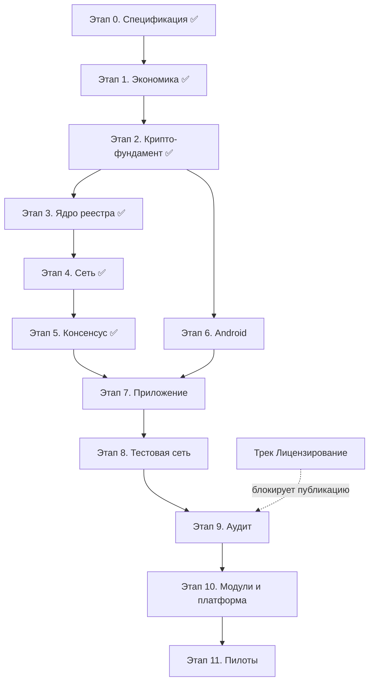

# План программирования платформы сетей доверия

Последовательность работ без привязки к датам. Основа — документ платформы v9.3 (разделы 3–19), в первую очередь дорожная карта раздела 19. Каждый этап имеет критерий готовности; следующий этап начинается, когда готов предыдущий (если не указано «параллельно»).

> **Обновлено 19.10.2026.** Этапы 0–5 выполнены. Зафиксированные параметры внесены по факту: K = 3, слоты 3/5/10, R = 10%, посевной круг ≥ 300 (этап 1); демередж 1% / 3000 периодов, комиссия rate ∈ [0.5; 2]%, P = 3000 / P_max = 30000 (этап 1.2); Snowball k = 10, α = 0.7, β = 4; epoch = 24 ч (№16), M = 21 (№17), seed_sunset = 100 active / 24 эпохи (№15), граница малых сетей ~100 участников (этап 5). Промежуточные релизы опубликованы: Zenodo 10.5281/zenodo.23452922 (equality-simulation), 10.5281/zenodo.23351012 (trust-networks-platform).

---

## Этап 0. Спецификация протокола — ✅ выполнено

Формализовать документ до вида, по которому можно писать код и тесты.

- [x] Wire-формат всех транзакций (раздел 9.3): protobuf-схемы, поля `wallet`, `seq`, `prev`, `type`, `payload`, `timestamp_claim`, `protocolVersion`, подпись.
- [x] Формат genesis-пакета и манифеста сети (разделы 3.3, 4): схема полей, хеш манифеста, `mutable_bounds`, посевной круг.
- [x] Правила проверки каждого типа транзакции каждым узлом — таблицы «условие → принять/отклонить» для всех типов ядра.
- [x] Инварианты ядра (раздел 3.2) как проверяемые утверждения INV-1..14.
- [x] Тестовые векторы: корректные транзакции, эквивокация, двойной выпуск, мораторий, окно накопления.
- [x] Черновик машины состояний кошелька: `registered → active → expired`, метка `flagged`, слоты поручителя.

**Готовность:** ✅ спецификация v1 с тестовыми векторами (`spec/` 00–07, `proto/`, `vectors/` — 20 векторов, `QUESTIONS.md`).

**Открытые вопросы, закрытые здесь:** формат чекпоинта ✅ (`spec/07`); схема пороговой подписи ✅ — N-из-M из набора подписей ECDSA P-256 (не BLS).

---

## Этап 1. Параметры сети: экономика и защита от ферм

### 1.1 Экономика поручительств и фермы — ✅ выполнено

Реализовано и опубликовано: репозиторий `equality-simulation` (Python, агентная модель):

- честный рост через поручительства: K, слоты 3/5/10, возраст поручителя ≥ 3 мес., слот освобождается после 3 выпусков поручаемого или 3 мес. без активации;
- ферма: покупка устройств, проникновение к честным поручителям, рост кольцом взаимных поручительств;
- экономика фермы: стоимость устройства и электричества, утечка 10% выпуска первым 12 периодам поручителям; главная метрика — безубыточная цена единицы;
- прогнанные сценарии: K = 2–5, узкие и щедрые слоты, проникновение 0–20 кошельков/мес., посевной круг 50–1000, бюджет фермы 5–100 устройств/мес.

Что осталось по этой модели:

- [x] Зафиксировать выбор K, S, R отчётом по результатам прогонов (раздел 17). ✅ Зафиксировано: K = 3, слоты 3/5/10, R = 10%, посевной круг ≥ 300 — обновлён раздел 7.7 KNOWLEDGE.md (v9.2) и таблица раздела 17.
- [ ] Калибровка допущений честного роста на реальном сообществе (закроется первым пилотом профиля 1).
- [ ] Расширить ту же модель: демередж, комиссия, мораторий на вывод — сейчас не моделируются.

### 1.2 Параметры — ✅ закрыты (отчёт 1.2, equality-simulation/Mistral/REPORT.md, раздел 5)

- [x] P и `P_max` отложенного перевода (раздел 8.3, вопрос 4 раздела 18) — **P = 3000, P_max = 30000**.
- [x] Демередж для профилей 5 и 7 — **1% / 3000 периодов**.
- [x] `fee_min`, границы `[rate_min, rate_max]`, целевой рост предложения — **адаптивная rate ∈ [0.5; 2]%, fee_min = 0.01**.

Значения реализованы в `core/params` (этап 3); туда же — окно переводимости свежих выпусков 3 мес. (`fresh_transfer_window_periods`, вопрос №11).

### 1.3 Симуляция реестра и консенсуса — перенесена в этап 5, выполнена там ✅

Конфликты, эквивокация, двойной выпуск, потеря связности, голосование и чекпоинты на сотнях узлов — это симуляция протокола, а не экономики. Выполнена в Go headless-ядре как «проверка до реализации» (раздел 9.1) в этапе 5.

**Готовность этапа 1:** ✅ K/S/R подтверждены отчётом; демередж, комиссия и P выбраны прогонами расширенной Python-модели.

---

## Этап 2. Криптографический фундамент ядра — ✅ выполнено (подэтап 3.0, ветка stage3-core)

- [x] Подписи ECDSA P-256 (`crypto/ecdsa`); фиксация формата ключа и адреса (`walletFingerprint`).
- [x] PoW: лёгкий (на `transfer`) и memory-hard на базе Argon2id (`x/crypto/argon2`) для `register` и выпуска; параметры под средний телефон — таргеты финализируются замерами на устройстве (этап 6, вопрос №9).
- [x] Sparse Merkle-дерево состояния (балансы + `seq`): построение, включение, доказательства для лёгких узлов.
- [x] Пороговая подпись чекпоинтов: N-из-M из набора подписей ECDSA P-256 (решение этапа 0), режимы `decentralized` и `members_quorum`.
- [x] Разбор цепочки аппаратной аттестации Android через `encoding/asn1`: синтетические корни для тестов; реальные цепочки Google, `verifiedBootState`, `deviceLocked`, уровень патча — на живом устройстве в этапе 6 (№23 → вопрос 7).

**Готовность:** ✅ все криптопримитивы ядра покрыты тестами, включая векторы аттестации (синтетические; реальные — этап 6).

---

## Этап 3. Ядро реестра (без сети) — ✅ выполнено (ветка stage3-core, c7e7df1; отчёт core/REPORT-stage3.md)

- [x] SQLite-хранилище (раздел 12.5): цепочки, индекс «фингерпринт → адрес», данные лёгкого узла, заголовки чекпоинтов.
- [x] `register`: аттестация + усиленный PoW, один фингерпринт = один адрес, запрет второго кошелька на уровне приложения.
- [x] `vouch`: K поручительств, возрастной порог, пул слотов по возрасту, освобождение слота.
- [x] `mint`: `periodic_equal`, `period − 1` при первом, окно накопления 6 мес., челлендж в рандомном слоте ±48 ч, доля R поручителям из первых 12 выпусков.
- [x] `transfer`: сжигаемая комиссия (адаптивная `rate` на границе эпохи), мораторий 14 дн., отложенные крупные переводы (порог P, задержка D = 48 ч, отмена, повышение P через 48 ч).
- [x] Демередж: детерминированный эффективный остаток, без транзакций списания.
- [x] `evidence`: закрытый перечень (эквивокация, двойной выпуск), мягкие последствия — метка `flagged`, приостановка выпуска, прекращение доли поручителям.
- [x] `migrate` и гардианы: личные 2 из 3, публичные 3 из 5, задержка 14 дней и отмена, перенос возраста и истории, чёрный список фингерпринтов, лимит G_max.
- [x] Смена параметров (`params_mutable`): предложение → окно подписей → порог ≥ 2/3 → задержка ≥ 30 дней → активация в эпоху; неретроактивность; сборка форк-пакета одной командой.
- [x] Fuzzing и property-based тесты на инварианты ядра из этапа 0.

**Готовность:** ✅ ядро проходит полный набор тестов спецификации (12/12 векторов, property-поток 400 операций с INV, метаморфные мутации, сквозной сценарий, сеттлемент).

---

## Этап 4. Сеть (go-libp2p) — ✅ выполнено (ветка stage4-network, 7853874; отчёт reports/REPORT-STAGE-4.md)

- [x] Транспорт QUIC/TCP, Noise, DHT (Kademlia), GossipSub.
- [x] Bootstrap-каскад (раздел 12.3): кэш пиров → подписанные seed-списки → зашитый список в APK → NSD/mDNS → Bluetooth-скан → QR → ручной ввод; peer exchange.
- [x] Hole punching и circuit relay через добровольные полные узлы (CGNAT) — DCUtR + circuit relay v2, эмуляция в тестах.
- [x] Уровни узлов (раздел 12.2): полный / лёгкий, переключение по условиям (зарядка + Wi-Fi).
- [x] `invite_only`-сети: ключ сети в приглашении (QR/ссылка), фильтрация пиров по `network_id`.
- [x] Защита от eclipse: смешивание источников, подтверждение от N несвязанных пиров (№35: Peer ID — сделано; подсети/ASN — этап 6); тест изоляции узла.
- [x] Bluetooth-канал (раздел 12.4): SideChannel — прямая передача подписанной транзакции, статус «ожидает публикации», проверка `seq`/`prev` при публикации.

**Готовность:** ✅ headless-узлы на разных машинах синхронизируют реестр; eclipse-тест пройден.

---

## Этап 5. Консенсус: голосование, чекпоинты, эпохи — ✅ выполнено (ветка stage5-consensus, локальная; отчёт reports/REPORT-STAGE-5.md)

Зафиксировано симуляцией и утверждено 18.10.2026: Snowball k = 10, α = 0.7, β = 4, веса по возрасту + аттестации; №16 epoch = 24 ч; №17 M = 21; №15 seed_sunset = 100 `active` / 24 эпохи; граница малых сетей `members_quorum` — ~100 участников.

- [x] Выборочное голосование: повторяющийся опрос выборки пиров, веса по возрасту и аттестации кошельков.
- [x] Чекпоинты: подписанный пороговой подписью корень состояния, режимы `decentralized` / `members_quorum`, переходный режим посевного круга с расписанием `seed_sunset`.
- [x] Сетевое время (раздел 9.2): эпохи как источник правды, допуск timestamp ±30 мин, предел сдвига между чекпоинтами.
- [x] Симуляция на сотнях виртуальных узлов (требование раздела 9.1): все 8 сценариев, детерминированная по seed.

**Готовность:** ✅ финальность 4 раунда (= β) во всех агрессивных сценариях; злонамеренные до 30% — честная ветка побеждает; поведение при разделении задокументировано; граница малых сетей определена; чекпоинты подписываются во всех трёх режимах; лёгкий узел проверяет доказательство по чекпоинту.

---

## Этап 6. Android-платформа (Kotlin + связка с ядром) — в работе

Можно начинать после этапа 2, параллельно этапам 3–5: проверка Keystore и аттестации на устройствах не зависит от сети. Фактически выполняется после этапа 5: ветка `stage6-android` от `stage5-consensus`. Промпт: `prompts/stage-6-prompt.md`.

- [ ] **Подэтап 6.0 — долги:** подпись ответов голосования в сети (cons/net, долг этапа 5); несвязанность eclipse-пиров по подсетям/ASN (№35, хвост этапа 4); закрепление утверждённых №15/№16/№17 и границы малых сетей в `QUESTIONS.md` и params/genesis.
- [ ] Интеграция ядра: `gomobile bind` (AAR) или `c-shared` + `dart:ffi` — выбрать по замерам; foreground service, platform channels, protobuf-обмен.
- [ ] Keystore: ключевая пара с `setAttestationChallenge`, `setUserAuthenticationRequired(true)` на каждую операцию, `setInvalidatedByBiometricEnrollment(true)`, `BIOMETRIC_STRONG`.
- [ ] Подтвердить на целевых устройствах: ECDSA P-256 везде, поддержка Ed25519, разбор расширения аттестации (вопрос 7 раздела 18).
- [ ] Экран биометрии: отказ в регистрации без настроенной биометрии, системный экран добавления отпечатка.
- [ ] PIN: обычный и тревожный (раздел 8.2), неразличимость, отключение входа по отпечатку при включённом тревожном, режим-приманка без использования ключа подписи.
- [ ] `allowBackup=false`, получение актуального `seq` от нескольких пиров перед подписью.
- [ ] Bluetooth-передача транзакции, NSD/mDNS-обнаружение для локальной Wi-Fi-сети.
- [ ] Замеры ресурсов (раздел 12.1): размер сборки, память, энергия, DHT в клиентском режиме; лёгкий режим узла; финализация таргетов PoW №9.

**Готовность:** реальный телефон регистрирует кошелёк, подписывает и проверяет транзакции через ядро; замеры зафиксированы.

---

## Этап 7. Приложение (Flutter)

- [ ] Онбординг: создание кошелька, обязательное предложение гардианов при создании, настройка биометрии.
- [ ] Поручительства: QR и Bluetooth при личной встрече, статус кандидата, слоты.
- [ ] Кошелёк: баланс, история, выпуск с челленджем, переводы, отложенные переводы с отменой, Bluetooth-платёж со статусом «ожидает публикации».
- [ ] Реестр и репутация: публичная история, возраст, глубина графа поручительств, статистика поручителя.
- [ ] Миграция: запуск, отмена, публичные гардианы, перезапуск с новыми поручительствами.
- [ ] Интерфейс режима-приманки: правдоподобный остаток и история, «ожидает подтверждения».

**Готовность:** полный путь нового участника: регистрация → поручительства → выпуск → перевод.

---

## Этап 8. Закрытая тестовая сеть на реальных устройствах

- [ ] Посевной круг из нескольких человек, разные производители и версии Android.
- [ ] Прогон: регистрация, аттестация, `vouch`, выпуск, челлендж, переводы, комиссия, миграция, Bluetooth-передача, отложенный перевод, `evidence` на специально созданной эквивокации.
- [ ] Тест холодного старта: первые ~10 узлов, локальный Wi-Fi без интернета.
- [ ] Тест принуждения: тревожный PIN в реалистичном сценарии.

**Готовность:** все сценарии работают на реальных устройствах без серверов.

---

## Этап 9. Аудит

- [ ] Независимый аудит криптографии (подписи, PoW, Merkle, пороговые подписи).
- [ ] Аудит консенсуса (голосование, чекпоинты, eclipse).
- [ ] Аудит разбора аттестации и защиты владельца (тревожный PIN, отложенные переводы).
- [ ] Исправления и повторная проверка критических и высоких находок.

**Готовность:** отчёт аудита, критические находки закрыты. Промежуточные релизы (Zenodo, GitHub) уже опубликованы по решению пользователя; дальнейшие публикации и продвижение — после аудита и трека «Лицензирование».

---

## Этап 10. Модули и платформа профилей

- [ ] `attest` + проверяющая библиотека (Go; сборки JVM и JS — вопрос 15): подпись кошелька, Merkle-доказательство из чекпоинта, `challenge`, срок годности, `H(address ‖ app_id)`; лёгкий клиент-синхронизатор.
- [ ] `redeem`: погашение с `resource_id`, квоты `quota_reset`, подписанные `receipt`.
- [ ] `pool`: `pool_create/donate/close/claim`, режимы выпуска, возврат.
- [ ] `contribution`: `contribution_claim/confirm`, подтверждения `peer`, лимиты, потолки, выплата из пула.
- [ ] `sandbox`: синтетические кошельки, headless-режим, экспорт реестра для анализа.
- [ ] Конфигуратор сети: выбор шаблона профиля, параметры, genesis-пакет + приложение, вычисление уровня гарантий из манифеста.
- [ ] Шаблоны семи профилей (раздел 5) и их валидация (например, запрет `relaxed` при высоких ставках).

**Готовность:** организатор без программирования создаёт сеть-инстанс по шаблону; верификатор проверяет предъявление в стороннем приложении.

---

## Этап 11. Пилоты по профилям

Порядок юридического риска (раздел 16.4): **1 → 2 → 3 → 6 → 5 и 4 → 7**. Каждый пилот — отдельная сеть-инстанс в существующем сообществе.

- [ ] Профиль 1: лаборатория в образовании (песочница, локальный Wi-Fi).
- [ ] Профиль 2: доказательство человечности — первый сторонний потребитель с верификатором.
- [ ] Профиль 3: равные квоты.
- [ ] Профиль 6: учёт вклада.
- [ ] Профили 5 и 4: внутренняя валюта / волонтёрская программа — после юр. проверки профиля 5.
- [ ] Профиль 7: касса взаимопомощи — после юр. проверки сбора средств.

**Готовность платформы:** каждый профиль имеет хотя бы один реальный пилот (требование раздела 2.3).

---

## Параллельные треки (не блокируют код, но имеют дедлайны «до публикации»)

| Трек | Что входит | Требование по сроку |
| --- | --- | --- |
| **Лицензирование** | Черновик LICENSE v0.1 (TNP-NC-0.1) опубликован в репозитории. Остались: юр. проверка текста, CLA, коммерческая лицензия, товарный знак, цена | ⚠️ Документ платформы и код уже публичны (Zenodo, GitHub): патентная стратегия (раздел 16.3) — срочно, дальнейшие публикации только после решения по патентам |
| **Юридические вопросы профилей** | Профили 5 и 7 — консультация юриста (вопрос 13), распространение через Google Play | До пилотов 5 и 7 |
| **Инфраструктура разработки** | CI, воспроизводимые сборки, подпись APK мультиподписью N-из-M, опубликованные хеши (раздел 13) | С этапа 3, полноценно — к этапу 8 |
| **Ключи проекта** | Владение и передача ключей подписи релизов и seed-списков (⏳ раздел 13) | До первого публичного релиза |

---

## Ключевые зависимости

Примечания:

- Этап 1 (экономика) закрыт репозиторием `equality-simulation`; параметры 1.2 зафиксированы отчётом 1.2 и реализованы в `core/params` (этап 3). Симуляция реестра и консенсуса выполнена в этапе 5.
- Этап 2 частично параллелен этапу 1; этап 6 можно начинать после этапа 2 — это ранний ответ на вопрос 7 раздела 18. Фактически этап 6 стартует после этапа 5: ветка `stage6-android` от `stage5-consensus`.
- Промежуточные публикации (Zenodo, GitHub) уже сделаны по решению пользователя; дальнейшие публикации — после этапа 9 и завершения трека «Лицензирование».
