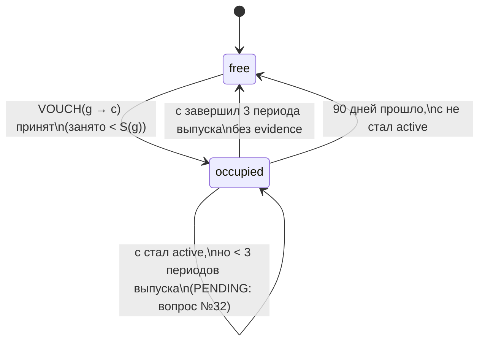

# 6. Машина состояний кошелька

Источник: разделы 7.3–7.5, 10.1, 11, 17.
Статусы и метки — разные вещи: `registered/active/expired` — статус,
`flagged/synthetic/seed` — метки (`WalletFlags`), ортогональные статусу.

## 6.1. Диаграмма статусов

```mermaid
stateDiagram-v2
    [*] --> registered : REGISTER (аттестация + усиленный PoW)
    registered --> active : K-й валидный VOUCH (K = 3)
    registered --> expired : 3 года без активации
    expired --> [*] : терминален для адреса;\nновая REGISTER с новым ключом
    active --> active : операции (mint, transfer, vouch, ...)
    registered --> registered : получает переводы;\ntransfer под мораторием
```



## 6.2. Таблица переходов статусов

| Из | Событие | Условия | В | Побочный эффект |
| --- | --- | --- | --- | --- |
| (нет) | `REGISTER` принята | аттестация (R1–R7, spec/03), фингерпринт уникален, усиленный PoW | `registered` | `registered_epoch`; `P(w) = P_default`; индекс `фингерпринт → адрес` |
| `registered` | `VOUCH` (K-я) | K = 3 валидных от разных `active`-кошельков (V1–V9) | `active` | `activated_epoch`; активирующее множество зафиксировано (доля R) |
| `registered` | граница эпохи | `epoch − registered_epoch > 3 лет` (7.3, 17) | `expired` | детерминированная проверка на границе эпохи |
| `expired` | — | терминален: активация невозможна; новая `REGISTER` создаёт ДРУГОЙ адрес (новый ключ → новый фингерпринт) | `expired` | полученные переводы остаются на адресе и доступны владельцу ключа (7.3) |
| `active` | `EVIDENCE` финализирована | эквивокация/двойной выпуск доказаны (E1–E7) | `active` + метка `flagged` | выпуск приостановлен на N мес. (PENDING: вопрос №12), повтор — навсегда; доля R поручителям = 0 |

Переходов `active → registered` и `active/registered → (нет)` не существует:
смена параметров неретроактивна и не отзывает `active` (3.2); статус не
отбирается ни большинством, ни меткой.

## 6.3. Метки (ортогональны статусу)

| Метка | Кто ставит | Снимается | Действие |
| --- | --- | --- | --- |
| `flagged` | финализация `EVIDENCE` (7.5) | никогда (постоянная) | приостанавливает `mint` на N мес. (повтор — навсегда); прекращает долю R поручителям; НЕ блокирует переводы и НЕ конфискует баланс (денежных штрафов нет) |
| `synthetic` | `REGISTER` в песочнице (6.5) | нет | особых прав нет: проходят `register` и поручительства, как все |
| `seed` | genesis (13) | `seed_sunset` | посевному кругу: 10 слотов в первый год, право подписи чекпоинтов переходного периода; после `seed_sunset` права теряются |

## 6.4. Машина слотов поручителя (7.4)

Слот — занятое поручительство. Пул слотов поручителя `g`:

```
S(g) = 10, если g ∈ посевной круг и age(g) < 1 года
     = tier по возрасту иначе: 3 при 3–12 мес., 5 старше 12 мес.
```



| Из | Событие | Условие | В |
| --- | --- | --- | --- |
| `free` | `VOUCH` от `g` за кандидата `c` принят | V1–V9; `occupied(g) < S(age(g))` | `occupied(c)` |
| `occupied(c)` | кандидат `c` (уже `active`) завершил 3 периода выпуска без `evidence` | `slot_free_mint_periods = 3` (7.4) | `free` |
| `occupied(c)` | прошло 90 дней (`slot_free_days`), `c` не стал `active` | 7.4 | `free` (vouch сгорает — PENDING: вопрос №33) |
| `occupied(c)` | `c` стал `active`, но не завершил 3 периодов | слот остаётся занятым неопределённо | `occupied(c)` — PENDING: вопрос №32 |

Правила:

- Поручитель отвечает за выбор ограниченным слотом и возможной потерей
  вознаграждения; залога нет (7.4).
- Максимальный рост сети за период оборота слота ≈ ×(1 + S/K) (7.4).
- Слоты не замедляют ферму относительно честной сети — обе растут к одному
  потолку; они защищают от мгновенного создания тысяч кошельков (7.4).
  Щедрые слоты (5/8/15) дают меньшую долю фермы, чем узкие (2/2/10), при той
  же скорости честного роста — подтверждено симуляцией (7.7); зафиксировано
  3/5/10.
- `flagged` у поручителя: слоты и метки не теряются (7.5 — «потери слотов нет»).

## 6.5. Возраст и время

- Возраст кошелька = `net_time − register_time` (сетевое время, не устройство;
  9.2). Пороги: поручитель ≥ 3 мес.; публичный гардиан ≥ 12 мес.; истечение
  `registered` — 3 года; мораторий — 7–30 дней от `register`.
- Все проверки возраста узел делает по сетевому времени эпохи — детерминированно
  и одинаково для всех узлов.

## 6.6. Подсостояния расходующих операций (не статусы кошелька)

- `TRANSFER/send` с `amount > P(w)`: `pending` → (`executed` по финализации
  после 48 ч без отмены | `canceled` по `TRANSFER/cancel`).
- `MIGRATE/propose`: `pending` → (`executed` через 14 дней без отмены |
  `canceled` по `MIGRATE/cancel` старым ключом).
- `CONTRIBUTION_CLAIM`: `pending` → (`confirmed` при N подтверждениях |
  не подтверждён).
